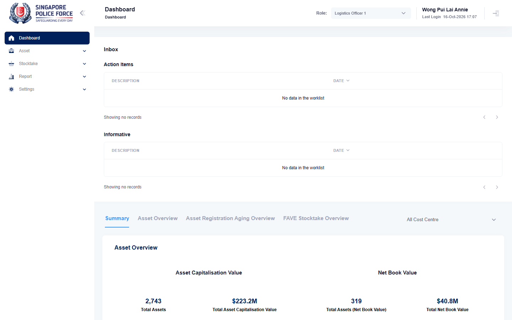

# Run report: mha-mobile / playwright / staging

| Field | Value |
|---|---|
| Result | **FAIL (1 failed)** |
| Run | 2026-10-16_1636_staging_playwright |
| Runner | playwright |
| Base URL | https://mhauatweb.southeastasia.cloudapp.azure.com/ |
| Started | 2026-10-16 16:36 |
| Duration | 37.5s |

## Summary

| Total | Pass | Fail | Flaky | Blocked | Skipped |
|---:|---:|---:|---:|---:|---:|
| 1 | 0 | 1 | 0 | 0 | 0 |

## Results

| ID | Title | Status | Checks | Time | Notes | Evidence |
|---|---|---|---|---|---|---|
| MHM-022 | assign and relocate made on the mobile app is auto-approved on mha web | fail | 7/8 | 35.1s | untriaged | [1](screenshots/MHM-022-a1-1.png) [2](traces/MHM-022-a1-3.zip) |

## Failures and warnings

### MHM-022: assign and relocate made on the mobile app is auto-approved on mha web (fail)

- Failure type: untriaged
- Source: `projects/mha-mobile/tests/e2e/assignment/assign.spec.ts`
- Failed: Step: MHA web: a cost centre of the phone (actual: `RpcError: failed to dump UI from device Medium_Phone_API_36.1: failed to get view tree dump: failed to run uiautomator dump: exit status 0xffffffff`)
- Error: RpcError: failed to dump UI from device Medium_Phone_API_36.1: failed to get view tree dump: failed to run uiautomator dump: exit status 0xffffffff

## Notes

Playwright project "mha-mobile". Full Playwright HTML report: reports/playwright-html/index.html, open with npm run report (overwritten by the next run).
