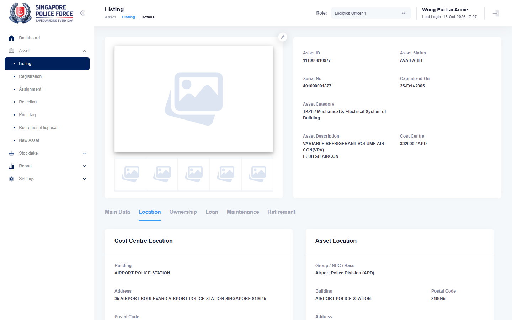

# Run report: mha-mobile / playwright / staging

| Field | Value |
|---|---|
| Result | **FAIL (1 failed)** |
| Run | 2026-10-16_1638_staging_playwright |
| Runner | playwright |
| Base URL | https://mhauatweb.southeastasia.cloudapp.azure.com/ |
| Started | 2026-10-16 16:38 |
| Duration | 5m 6s |

## Summary

| Total | Pass | Fail | Flaky | Blocked | Skipped |
|---:|---:|---:|---:|---:|---:|
| 1 | 0 | 1 | 0 | 0 | 0 |

## Results

| ID | Title | Status | Checks | Time | Notes | Evidence |
|---|---|---|---|---|---|---|
| MHM-022 | assign and relocate made on the mobile app is auto-approved on mha web | fail | 126/128 | 5m 2s | untriaged | [1](screenshots/MHM-022-a1-1.png) [2](traces/MHM-022-a1-3.zip) |

## Failures and warnings

### MHM-022: assign and relocate made on the mobile app is auto-approved on mha web (fail)

- Failure type: untriaged
- Source: `projects/mha-mobile/tests/e2e/assignment/assign.spec.ts`
- Failed: Step: 5. Cleanup: relocate it back to the original room from the phone (the FALO stays; MHM-016 recalls it) (actual: `LocatorError: Locator: no matching element found after 15000ms`)
- Failed: Step: locator.tap() (actual: `LocatorError: Locator: no matching element found after 15000ms`)
- Error: LocatorError: Locator: no matching element found after 15000ms

## Notes

Playwright project "mha-mobile". Full Playwright HTML report: reports/playwright-html/index.html, open with npm run report (overwritten by the next run).
