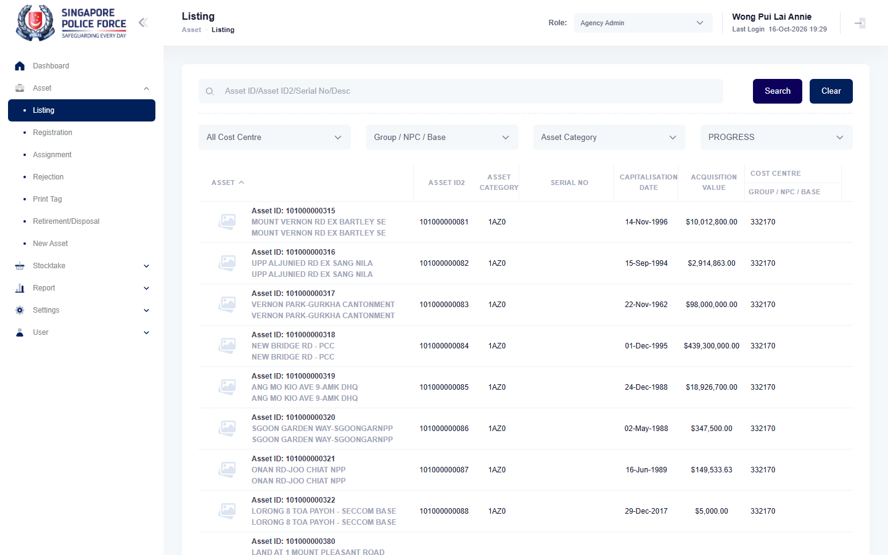

# Run report: mha-mobile / playwright / staging

| Field | Value |
|---|---|
| Result | **FAIL (1 failed)** |
| Run | 2026-10-16_1844_staging_playwright |
| Runner | playwright |
| Base URL | https://mhauatweb.southeastasia.cloudapp.azure.com/ |
| Started | 2026-10-16 18:44 |
| Duration | 10m 9s |

## Summary

| Total | Pass | Fail | Flaky | Blocked | Skipped |
|---:|---:|---:|---:|---:|---:|
| 1 | 0 | 1 | 0 | 0 | 0 |

## Results

| ID | Title | Status | Checks | Time | Notes | Evidence |
|---|---|---|---|---|---|---|
| MHM-023 | asset registration form pre-fills the asset's location remarks | fail | 4/5 | 10m 6s | untriaged; BUG-004 | [1](screenshots/MHM-023-a1-1.png) [2](traces/MHM-023-a1-3.zip) |

## Failures and warnings

### MHM-023: asset registration form pre-fills the asset's location remarks (fail)

- Failure type: untriaged (bug BUG-004)
- Source: `projects/mha-mobile/tests/e2e/registration/registration.spec.ts`
- Failed: Step: 1. Phone: Asset Registration lists a PROGRESS asset that has location remarks on MHA web (actual: `Error: page.evaluate: Test timeout of 600000ms exceeded.`)
- Error: Test timeout of 600000ms exceeded.
- Note: Expected failure, known bug: BUG-004: the Register Asset form shows Remarks empty ("(Optional)") and saving clears the asset's remarks

## Notes

Playwright project "mha-mobile". Full Playwright HTML report: reports/playwright-html/index.html, open with npm run report (overwritten by the next run).
