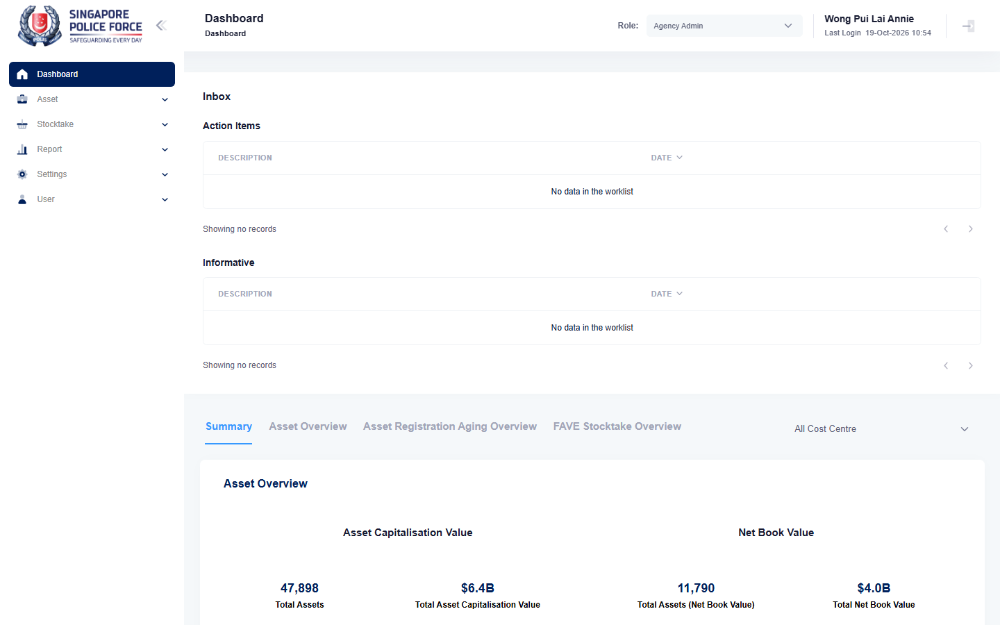

# Run report: mha-mobile / playwright / staging

| Field | Value |
|---|---|
| Result | **FAIL (1 failed)** |
| Run | 2026-10-19_1009_staging_playwright |
| Runner | playwright |
| Base URL | https://mhauatweb.southeastasia.cloudapp.azure.com/ |
| Started | 2026-10-19 10:09 |
| Duration | 6m 20s |

## Summary

| Total | Pass | Fail | Flaky | Blocked | Skipped |
|---:|---:|---:|---:|---:|---:|
| 2 | 1 | 1 | 0 | 0 | 0 |

## Results

| ID | Title | Status | Checks | Time | Notes | Evidence |
|---|---|---|---|---|---|---|
| MHM-013 | asset registration completes a progress asset from the phone | fail | 66/67 | 3m 11s | untriaged | [1](screenshots/MHM-013-a1-1.png) [2](traces/MHM-013-a1-3.zip) |
| MHM-023 | asset registration form pre-fills the asset's location remarks | pass | 66/67 | 2m 51s | BUG-004 | - |

## Failures and warnings

### MHM-013: asset registration completes a progress asset from the phone (fail)

- Failure type: untriaged
- Source: `projects/mha-mobile/tests/e2e/registration/registration.spec.ts`
- Failed: Step: 1. Phone: Logistics Officer 1, Asset Registration lists a PROGRESS asset; MHA web: its location (actual: `Error: The dropdown does not offer "332110"`)
- Error: Error: The dropdown does not offer "332110"

## Notes

Playwright project "mha-mobile". Full Playwright HTML report: reports/playwright-html/index.html, open with npm run report (overwritten by the next run).
