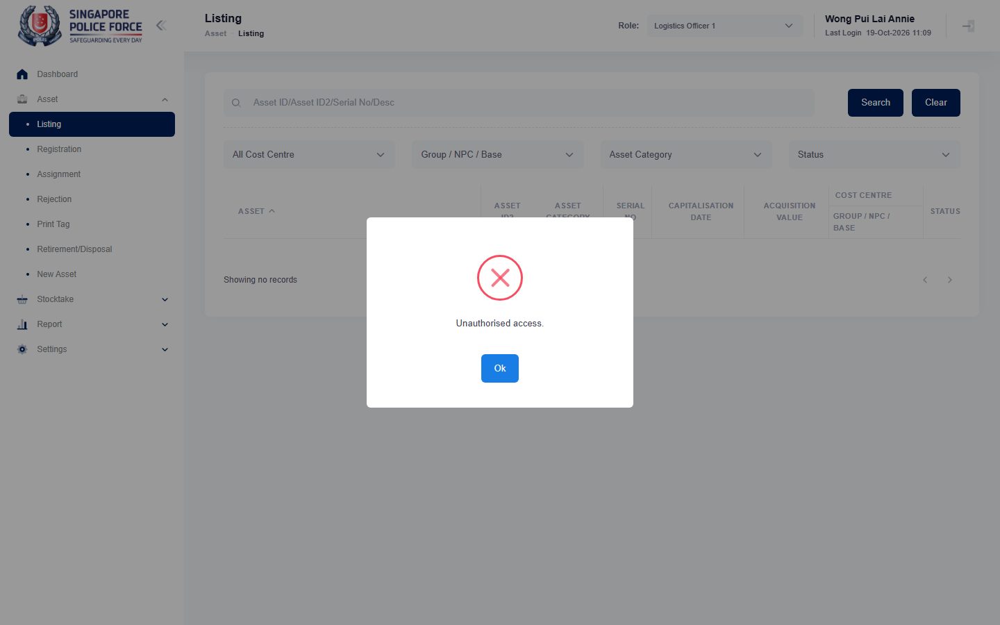

# Run report: mha-mobile / playwright / staging

| Field | Value |
|---|---|
| Result | **FAIL (1 failed)** |
| Run | 2026-10-19_1055_staging_playwright |
| Runner | playwright |
| Base URL | https://mhauatweb.southeastasia.cloudapp.azure.com/ |
| Started | 2026-10-19 10:55 |
| Duration | 2m 14s |

## Summary

| Total | Pass | Fail | Flaky | Blocked | Skipped |
|---:|---:|---:|---:|---:|---:|
| 2 | 0 | 1 | 0 | 0 | 1 |

## Results

| ID | Title | Status | Checks | Time | Notes | Evidence |
|---|---|---|---|---|---|---|
| MHM-009 | relocate form pre-fills the asset's location remarks | fail | 36/38 | 1m 48s | untriaged | [1](screenshots/MHM-009-a1-1.png) [2](traces/MHM-009-a1-3.zip) |
| MHM-019 | ad hoc stocktake assigned on mha web reaches the stocktaker's mobile app | skipped | 3/4 | 19.0s | - | - |

## Failures and warnings

### MHM-009: relocate form pre-fills the asset's location remarks (fail)

- Failure type: untriaged
- Source: `projects/mha-mobile/tests/e2e/assignment/relocate.spec.ts`
- Failed: Step: 1. MHA web: an asset with location remarks (actual: `Error: expect(locator).toBeVisible() failed  Locator: getByRole('heading', { name: 'Listing', level: 1 })`)
- Failed: Expect "toBeVisible" (actual: `Error: expect(locator).toBeVisible() failed  Locator: getByRole('heading', { name: 'Listing', level: 1 })`)
- Error: Error: expect(locator).toBeVisible() failed  Locator: getByRole('heading', { name: 'Listing', level: 1 }) Expected: visible Timeout: 5000ms Error: element(s) not found  Call log:   - Expect "toBeVisible" getByRole('heading', { name: 'Listing', level: 1 }) with timeout 5000ms   - waiting for getByRole('heading', { name: 'Listing', level: 1 }) 

## Notes

Playwright project "mha-mobile". Full Playwright HTML report: reports/playwright-html/index.html, open with npm run report (overwritten by the next run).
