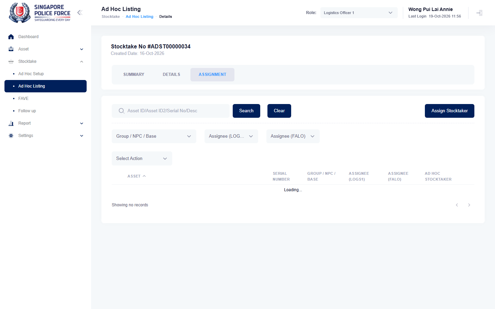

# Run report: mha-mobile / playwright / staging

| Field | Value |
|---|---|
| Result | **FAIL (1 failed)** |
| Run | 2026-10-19_1101_staging_playwright |
| Runner | playwright |
| Base URL | https://mhauatweb.southeastasia.cloudapp.azure.com/ |
| Started | 2026-10-19 11:01 |
| Duration | 24.6s |

## Summary

| Total | Pass | Fail | Flaky | Blocked | Skipped |
|---:|---:|---:|---:|---:|---:|
| 1 | 0 | 1 | 0 | 0 | 0 |

## Results

| ID | Title | Status | Checks | Time | Notes | Evidence |
|---|---|---|---|---|---|---|
| MHM-019 | ad hoc stocktake assigned on mha web reaches the stocktaker's mobile app | fail | 8/10 | 20.1s | untriaged | [1](screenshots/MHM-019-a1-1.png) [2](traces/MHM-019-a1-3.zip) |

## Failures and warnings

### MHM-019: ad hoc stocktake assigned on mha web reaches the stocktaker's mobile app (fail)

- Failure type: untriaged
- Source: `projects/mha-mobile/tests/e2e/stocktake/adhoc.spec.ts`
- Failed: Step: 1. MHA web (LOGS1): the newest one-off "QA auto mobile adhoc" has TAN JUN YONG SHAWN as stocktaker (actual: `Error: the ad hoc stocktake has an asset  expect(received).not.toBe(expected) // Object.is equality`)
- Failed: the ad hoc stocktake has an asset (actual: `Error: the ad hoc stocktake has an asset  expect(received).not.toBe(expected) // Object.is equality`)
- Error: Error: the ad hoc stocktake has an asset  expect(received).not.toBe(expected) // Object.is equality  Expected: not ""

## Notes

Playwright project "mha-mobile". Full Playwright HTML report: reports/playwright-html/index.html, open with npm run report (overwritten by the next run).
