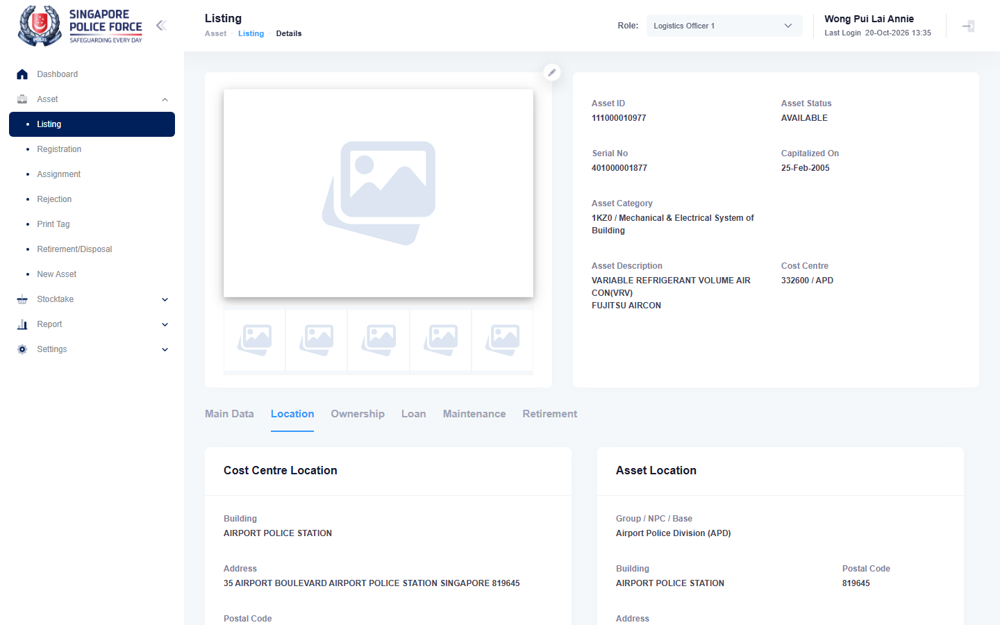

# Run report: mha-mobile / playwright / staging

| Field | Value |
|---|---|
| Result | **FAIL (2 failed)** |
| Run | 2026-10-20_1329_staging_playwright |
| Runner | playwright |
| Base URL | https://mhauatweb.southeastasia.cloudapp.azure.com/ |
| Started | 2026-10-20 13:29 |
| Duration | 90m 51s |

## Summary

| Total | Pass | Fail | Flaky | Blocked | Skipped |
|---:|---:|---:|---:|---:|---:|
| 21 | 17 | 2 | 1 | 0 | 1 |

## Results

| ID | Title | Status | Checks | Time | Notes | Evidence |
|---|---|---|---|---|---|---|
| MHM-001 | home page loads | pass | 5/5 | 3.9s | - | - |
| MHM-002 | stocktaker logs in on the mobile app with the account from .env | pass | 30/30 | 32.1s | - | - |
| MHM-003 | login with an unknown username is refused | pass | 25/25 | 30.8s | - | - |
| MHM-004 | switching to stocktaker and a cost centre shows only that cost centre's stocktakes | pass | 71/71 | 3m 36s | - | - |
| MHM-005 | fave sighting submitted on the mobile app shows in mha web | pass | 90/90 | 3m 31s | - | - |
| MHM-006 | search asset shows the same asset data as mha web | pass | 108/108 | 2m 36s | - | - |
| MHM-008 | relocation made on the mobile app is approved and moves the asset on mha web | fail | 93/95 | 7m 38s | test-issue; attempt 2 | [1](screenshots/MHM-008-a1-1.png) [2](traces/MHM-008-a1-3.zip) [3](screenshots/MHM-008-a2-1.png) [4](traces/MHM-008-a2-3.zip) |
| MHM-009 | relocate form pre-fills the asset's location remarks | pass | 79/81 | 3m 18s | BUG-002 | - |
| MHM-010 | new asset reported on the mobile app shows on mha web | pass | 109/109 | 4m 11s | - | - |
| MHM-011 | fave sighting made offline is uploaded after reconnecting and shows on mha web | pass | 83/83 | 3m 31s | - | - |
| MHM-012 | home tiles follow the active role | flaky | 83/83 | 7m 28s | attempt 2 | [1](traces/MHM-012-a1-2.zip) |
| MHM-013 | asset registration completes a progress asset from the phone | pass | 113/113 | 4m 15s | - | - |
| MHM-014 | assignment to a falo made on the mobile app is auto-approved on mha web | pass | 117/117 | 4m 52s | - | - |
| MHM-015 | falo return made on the mobile app is approved by logs1 on mha web | pass | 160/160 | 6m 60s | - | - |
| MHM-016 | recall made on the mobile app needs uro approval and clears the falo | pass | 110/110 | 4m 23s | - | - |
| MHM-017 | fave not sighted result submitted on the mobile app opens an investigation on mha web | pass | 84/84 | 2m 53s | - | - |
| MHM-018 | fave sighting at a wrong location on the mobile app raises a relocation for logs1 | pass | 111/111 | 4m 34s | - | - |
| MHM-019 | ad hoc stocktake assigned on mha web is sighted on the stocktaker's mobile app | pass | 94/94 | 3m 23s | - | - |
| MHM-022 | assign and relocate made on the mobile app is auto-approved on mha web | fail | 148/150 | 11m 30s | test-issue; attempt 2 | [1](screenshots/MHM-022-a1-1.png) [2](traces/MHM-022-a1-3.zip) [3](screenshots/MHM-022-a2-1.png) [4](traces/MHM-022-a2-3.zip) |
| MHM-023 | asset registration form pre-fills the asset's location remarks | skipped | 119/120 | 4m 15s | - | - |
| MHM-024 | switch role offers only the cost centres of the role picked in the panel | pass | 62/64 | 4m 31s | BUG-005 | - |

## Failures and warnings

### MHM-008: relocation made on the mobile app is approved and moves the asset on mha web (fail)

- Failure type: test-issue
- Source: `projects/mha-mobile/tests/e2e/assignment/relocate.spec.ts`
- Failed: Step: 4. Room Q8GGZ, remarks as they are, Complete (actual: `ExpectError: Expected element to be visible, but it was not`)
- Failed: Step: expect.toBeVisible() (actual: `ExpectError: Expected element to be visible, but it was not`)
- Error: ExpectError: Expected element to be visible, but it was not
- Earlier attempt: fail (failed: Step: 6. Cleanup: relocate it back from the phone; Step: locator.fill("QXXV6"))
- Note: test-issue: cleanup Room clear failed, then a Complete tap was lost on the slow emulator; setField retry and Complete re-tap added; passes in run 2026-10-20_1501

### MHM-012: home tiles follow the active role (flaky)

- Source: `projects/mha-mobile/tests/e2e/role/home-tiles.spec.ts`
- Earlier attempt: fail (failed: Step: 3. Unit Resource Officer: Assign, Search Asset, Stocktake, New Asset, Settings; Step: expect.toEqual())

### MHM-022: assign and relocate made on the mobile app is auto-approved on mha web (fail)

- Failure type: test-issue
- Source: `projects/mha-mobile/tests/e2e/assignment/assign.spec.ts`
- Failed: Step: 5. Cleanup: relocate it back to the original room from the phone (the FALO stays; MHM-016 recalls it) (actual: `LocatorError: Failed to clear element`)
- Failed: Step: locator.fill("QQFCO") (actual: `LocatorError: Failed to clear element`)
- Error: LocatorError: Failed to clear element
- Earlier attempt: fail (failed: Step: 5. Cleanup: relocate it back to the original room from the phone (the FALO stays; MHM-016 recalls it); Step: expect.toBeVisible())
- Note: test-issue: cleanup Select Asset Search tap lost / Room clear failed on the slow emulator; Search re-tap, setField retry and Complete re-tap added; passes in run 2026-10-20_1501

## Notes

Playwright project "mha-mobile". Full Playwright HTML report: reports/playwright-html/index.html, open with npm run report (overwritten by the next run).
