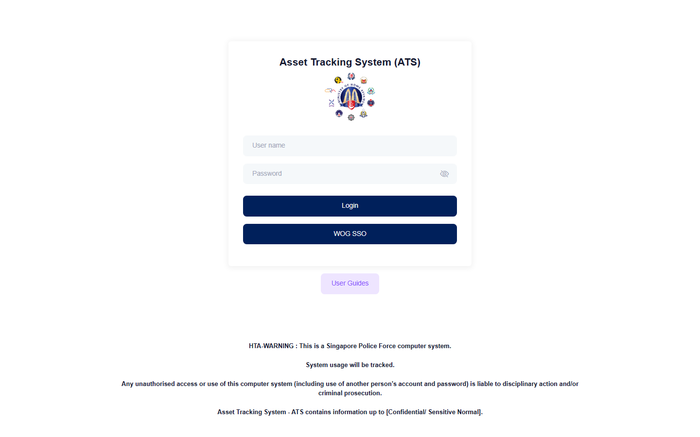
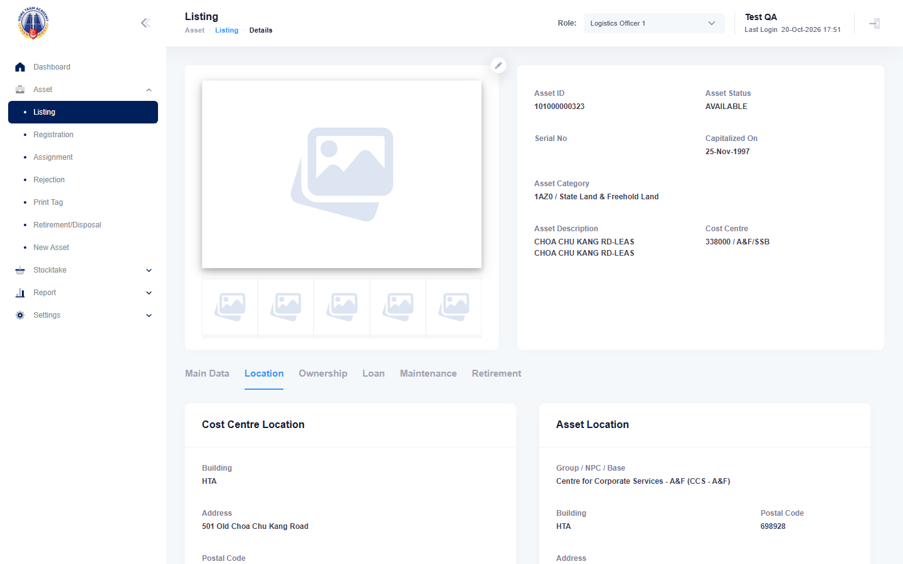
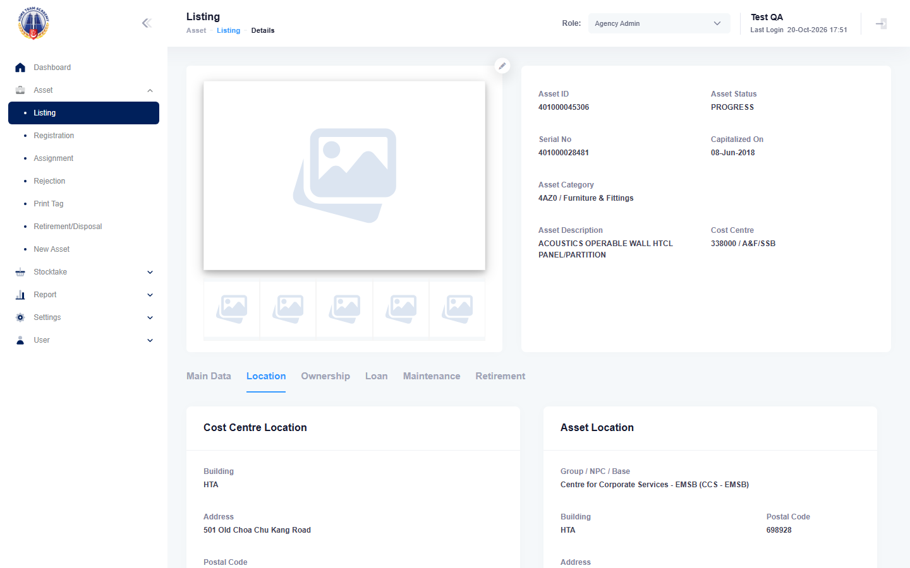
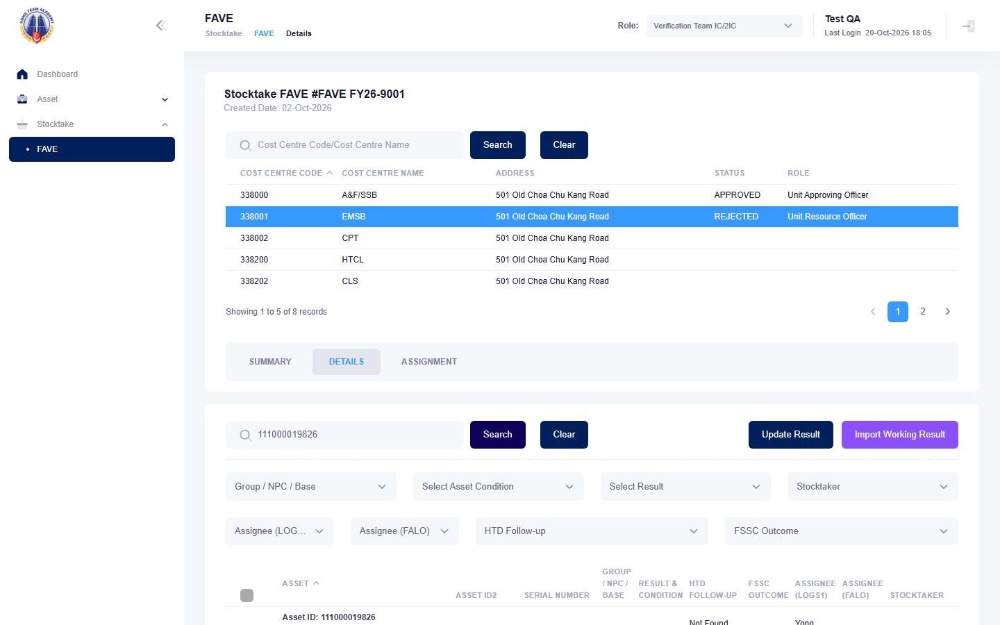
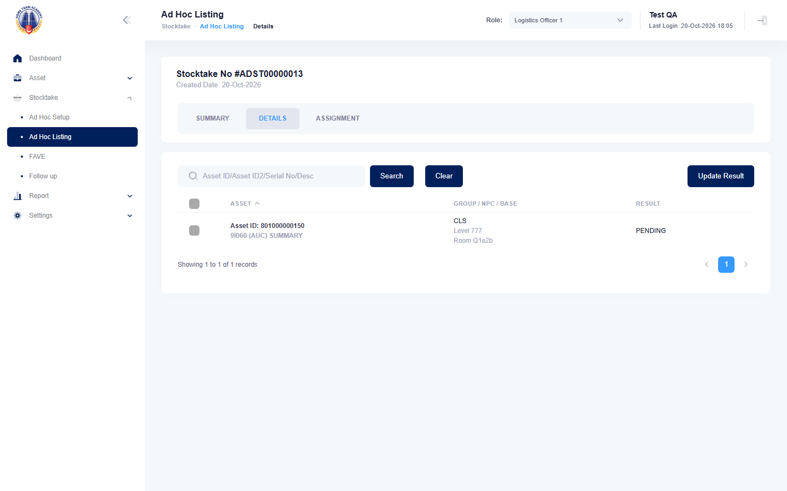

# Run report: mha-mobile / playwright / staging-hta

| Field | Value |
|---|---|
| Result | **FAIL (7 failed)** |
| Run | 2026-10-20_1704_staging-hta_playwright |
| Runner | playwright |
| Base URL | https://mhauatwebhta.southeastasia.cloudapp.azure.com/ |
| Started | 2026-10-20 17:04 |
| Duration | 37m 33s |

## Summary

| Total | Pass | Fail | Flaky | Blocked | Skipped |
|---:|---:|---:|---:|---:|---:|
| 21 | 9 | 7 | 1 | 0 | 4 |

## Results

| ID | Title | Status | Checks | Time | Notes | Evidence |
|---|---|---|---|---|---|---|
| MHM-001 | home page loads | pass | 5/5 | 1.1s | - | - |
| MHM-002 | stocktaker logs in on the mobile app with the account from .env | pass | 33/33 | 21.3s | - | - |
| MHM-003 | login with an unknown username is refused | pass | 28/28 | 20.3s | - | - |
| MHM-004 | switching to stocktaker and a cost centre shows only that cost centre's stocktakes | fail | 25/27 | 1m 38s | test-issue; attempt 2 | [1](traces/MHM-004-a1-2.zip) [2](traces/MHM-004-a2-2.zip) |
| MHM-005 | fave sighting submitted on the mobile app shows in mha web | flaky | 85/85 | 1m 55s | attempt 2 | [1](screenshots/MHM-005-a1-1.png) [2](traces/MHM-005-a1-3.zip) |
| MHM-006 | search asset shows the same asset data as mha web | fail | 1/2 | 1m 18s | environment; attempt 2 | [1](screenshots/MHM-006-a1-1.png) [2](traces/MHM-006-a1-3.zip) [3](screenshots/MHM-006-a2-1.png) [4](traces/MHM-006-a2-3.zip) |
| MHM-008 | relocation made on the mobile app is approved and moves the asset on mha web | pass | 112/112 | 2m 5s | - | - |
| MHM-009 | relocate form pre-fills the asset's location remarks | pass | 47/49 | 1m 14s | BUG-002 | - |
| MHM-010 | new asset reported on the mobile app shows on mha web | fail | 47/49 | 4m 23s | test-issue; attempt 2 | [1](screenshots/MHM-010-a1-1.png) [2](traces/MHM-010-a1-3.zip) [3](screenshots/MHM-010-a2-1.png) [4](traces/MHM-010-a2-3.zip) |
| MHM-011 | fave sighting made offline is uploaded after reconnecting and shows on mha web | pass | 83/83 | 1m 37s | - | - |
| MHM-012 | home tiles follow the active role | pass | 39/39 | 1m 6s | - | - |
| MHM-013 | asset registration completes a progress asset from the phone | fail | 50/52 | 4m 23s | test-issue; attempt 2 | [1](screenshots/MHM-013-a1-1.png) [2](traces/MHM-013-a1-3.zip) [3](screenshots/MHM-013-a2-1.png) [4](traces/MHM-013-a2-3.zip) |
| MHM-014 | assignment to a falo made on the mobile app is auto-approved on mha web | skipped | 9/10 | 56.0s | - | - |
| MHM-015 | falo return made on the mobile app is approved by logs1 on mha web | skipped | 0/1 | 19.4s | - | - |
| MHM-016 | recall made on the mobile app needs uro approval and clears the falo | skipped | 0/1 | 19.2s | - | - |
| MHM-017 | fave not sighted result submitted on the mobile app opens an investigation on mha web | pass | 84/84 | 1m 40s | - | - |
| MHM-018 | fave sighting at a wrong location on the mobile app raises a relocation for logs1 | fail | 65/67 | 5m 22s | test-issue; attempt 2 | [1](screenshots/MHM-018-a1-1.png) [2](traces/MHM-018-a1-3.zip) [3](screenshots/MHM-018-a2-1.png) [4](traces/MHM-018-a2-3.zip) |
| MHM-019 | ad hoc stocktake assigned on mha web is sighted on the stocktaker's mobile app | fail | 41/43 | 2m 23s | environment; attempt 2 | [1](screenshots/MHM-019-a1-1.png) [2](traces/MHM-019-a1-3.zip) [3](screenshots/MHM-019-a2-1.png) [4](traces/MHM-019-a2-3.zip) |
| MHM-022 | assign and relocate made on the mobile app is auto-approved on mha web | skipped | 0/1 | 19.1s | - | - |
| MHM-023 | asset registration form pre-fills the asset's location remarks | pass | 33/35 | 59.0s | BUG-004 | - |
| MHM-024 | switch role offers only the cost centres of the role picked in the panel | fail | 40/40 | 3m 49s | test-issue; BUG-005; attempt 2 | - |

## Failures and warnings

### MHM-004: switching to stocktaker and a cost centre shows only that cost centre's stocktakes (fail)

- Failure type: test-issue
- Source: `projects/mha-mobile/tests/e2e/role/switch-role.spec.ts`
- Failed: Step: The list holds only stocktakes of that cost centre, and the count matches (actual: `ExpectError: Expected "FAVE FY26-9001" to match /^FAVE FY\d{2}-20\d{2}$/`)
- Failed: Step: expect.toMatch() (actual: `ExpectError: Expected "FAVE FY26-9001" to match /^FAVE FY\d{2}-20\d{2}$/`)
- Error: ExpectError: Expected "FAVE FY26-9001" to match /^FAVE FY\d{2}-20\d{2}$/
- Earlier attempt: fail (failed: Step: The list holds only stocktakes of that cost centre, and the count matches; Step: expect.toMatch())
- Note: expected SPF FAVE numbers (agency 20); HTA uses 90 (FAVE FY26-9001); passes in 2026-10-20_1750

### MHM-005: fave sighting submitted on the mobile app shows in mha web (flaky)

- Source: `projects/mha-mobile/tests/e2e/stocktake/fave-sighting.spec.ts`
- Earlier attempt: fail

### MHM-006: search asset shows the same asset data as mha web (fail)

- Failure type: environment
- Source: `projects/mha-mobile/tests/e2e/asset/search-asset.spec.ts`
- Failed: Step: 1. MHA web: first AVAILABLE asset whose cost centre the phone offers (actual: `SessionEndedError: MHA web logged out: the session was ended, most likely by a newer login of the same account (one session per account).`)
- Error: SessionEndedError: MHA web logged out: the session was ended, most likely by a newer login of the same account (one session per account).
- Earlier attempt: fail (failed: Step: 1. MHA web: first AVAILABLE asset whose cost centre the phone offers)
- Note: HTA web session ended by a login to HTA web with the test account during the run (17:05); passes in run 2026-10-20_1817 (expected failure on BUG-006)

### MHM-010: new asset reported on the mobile app shows on mha web (fail)

- Failure type: test-issue
- Source: `projects/mha-mobile/tests/e2e/new-asset/new-asset.spec.ts`
- Failed: Step: 3-4. Condition, description, remarks, address, level, location remarks (actual: `LocatorError: Element not scrolled into view after 30 swipes`)
- Failed: Step: locator.scrollIntoViewIfNeeded() (actual: `LocatorError: Element not scrolled into view after 30 swipes`)
- Error: LocatorError: Element not scrolled into view after 30 swipes
- Earlier attempt: fail (failed: Step: 3-4. Condition, description, remarks, address, level, location remarks; Step: locator.scrollIntoViewIfNeeded())
- Note: HTA assets keep their own address text, so the exact row was not in "Select Address:-"; pickAddressRow now falls back to the row of the postal code; passes in 2026-10-20_1750

### MHM-013: asset registration completes a progress asset from the phone (fail)

- Failure type: test-issue
- Source: `projects/mha-mobile/tests/e2e/registration/registration.spec.ts`
- Failed: Step: 2. Room R771X, remarks as they are, one photo, Save (actual: `ExpectError: Expected element to have text "Registration Success", but no matching element was found`)
- Failed: Step: expect.toHaveText() (actual: `ExpectError: Expected element to have text "Registration Success", but no matching element was found`)
- Error: ExpectError: Expected element to have text "Registration Success", but no matching element was found
- Earlier attempt: fail (failed: Step: 2. Room R495S, remarks as they are, one photo, Save; Step: expect.toHaveText())
- Note: HTA PROGRESS asset had no Group/NPC/Base ("Please select location"); RegistrationScreen.ensureGroup picks one and the address again; passes in 2026-10-20_1811

### MHM-018: fave sighting at a wrong location on the mobile app raises a relocation for logs1 (fail)

- Failure type: test-issue
- Source: `projects/mha-mobile/tests/e2e/stocktake/fave-outcomes.spec.ts`
- Failed: Step: 2. Sighted on, Correct Location off; new location in Room QU9ST; SAVE > CONFIRM (actual: `LocatorError: Element not scrolled into view after 30 swipes`)
- Failed: Step: locator.scrollIntoViewIfNeeded() (actual: `LocatorError: Element not scrolled into view after 30 swipes`)
- Error: LocatorError: Element not scrolled into view after 30 swipes
- Earlier attempt: fail (failed: Step: 2. Sighted on, Correct Location off; new location in Room QQQA3; SAVE > CONFIRM; Step: locator.scrollIntoViewIfNeeded())
- Note: same address issue as MHM-010; passes in 2026-10-20_1750

### MHM-019: ad hoc stocktake assigned on mha web is sighted on the stocktaker's mobile app (fail)

- Failure type: environment
- Source: `projects/mha-mobile/tests/e2e/stocktake/adhoc.spec.ts`
- Failed: Step: 3. Phone: Stocktaker | 338202 > Stocktake (Ad Hoc) lists ADST00000013 (actual: `LocatorError: Locator: no matching element found after 15000ms`)
- Failed: Step: locator.tap() (actual: `LocatorError: Locator: no matching element found after 15000ms`)
- Error: LocatorError: Locator: no matching element found after 15000ms
- Earlier attempt: fail (failed: Step: 3. Phone: Stocktaker | 338202 > Stocktake (Ad Hoc) lists ADST00000013; Step: locator.tap())
- Note: HTA Stocktaker role had the MOBILE function Stocktake (Ad Hoc) off (same as BUG-003 on SPF); ticked 2026-10-20 ~17:45; passes in 2026-10-20_1750

### MHM-024: switch role offers only the cost centres of the role picked in the panel (fail)

- Failure type: test-issue (bug BUG-005)
- Source: `projects/mha-mobile/tests/e2e/role/switch-role-cost-centres.spec.ts`
- Earlier attempt: pass
- Note: Expected failure, known bug: BUG-005: Select Cost Center lists the previous role's cost centres (after login: all agency cost centres)
- Note: BUG-005 cannot show on HTA (same cost centres in every role): the test now skips then

## Notes

Playwright project "mha-mobile". Full Playwright HTML report: reports/playwright-html/index.html, open with npm run report (overwritten by the next run).
