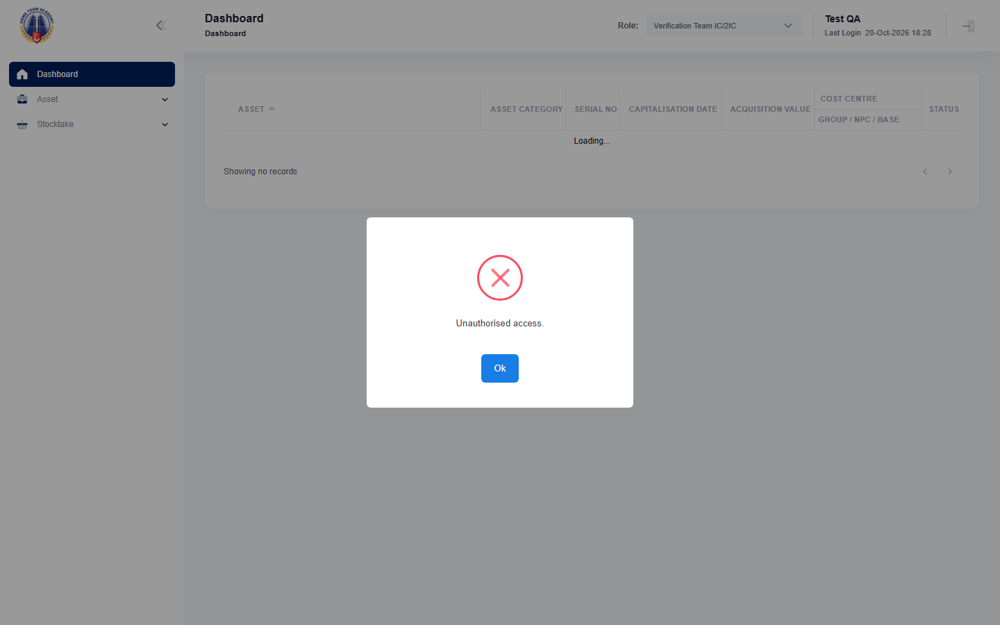
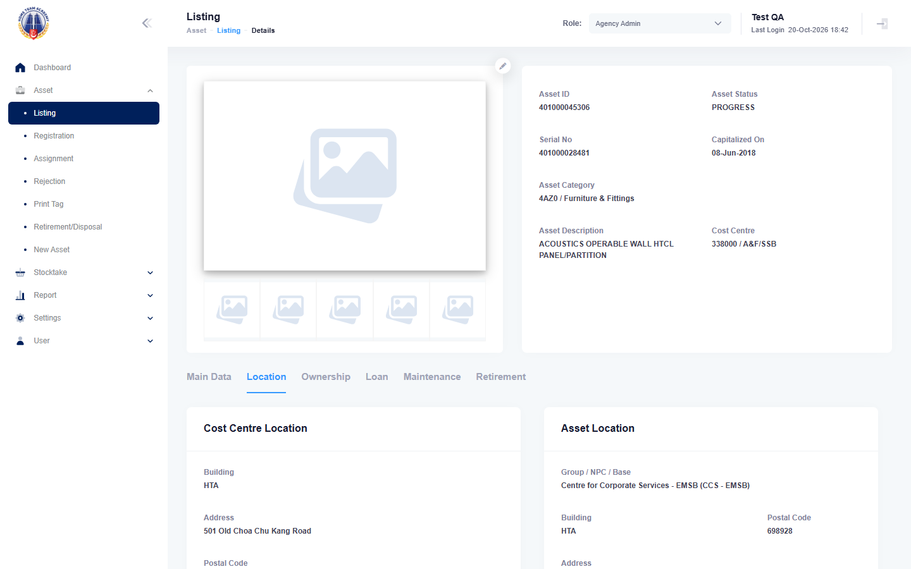
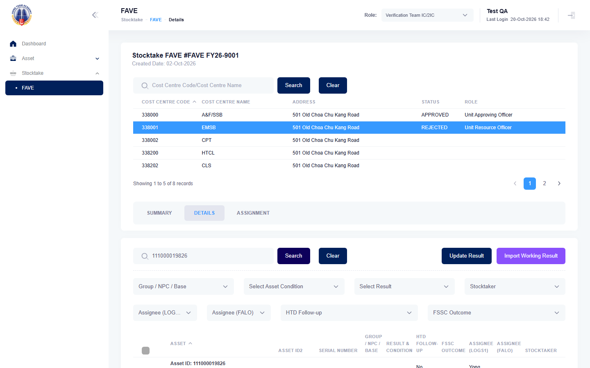

# Run report: mha-mobile / playwright / staging-hta

| Field | Value |
|---|---|
| Result | **FAIL (2 failed)** |
| Run | 2026-10-20_1750_staging-hta_playwright |
| Runner | playwright |
| Base URL | https://mhauatwebhta.southeastasia.cloudapp.azure.com/ |
| Started | 2026-10-20 17:50 |
| Duration | 18m 53s |

## Summary

| Total | Pass | Fail | Flaky | Blocked | Skipped |
|---:|---:|---:|---:|---:|---:|
| 7 | 2 | 2 | 2 | 0 | 1 |

## Results

| ID | Title | Status | Checks | Time | Notes | Evidence |
|---|---|---|---|---|---|---|
| MHM-004 | switching to stocktaker and a cost centre shows only that cost centre's stocktakes | pass | 54/54 | 1m 59s | - | - |
| MHM-006 | search asset shows the same asset data as mha web | fail | - | 1m 15s | test-issue; attempt 2 | [1](screenshots/MHM-006-a1-1.png) [2](traces/MHM-006-a1-3.zip) [3](screenshots/MHM-006-a2-1.png) [4](traces/MHM-006-a2-3.zip) |
| MHM-010 | new asset reported on the mobile app shows on mha web | flaky | 102/102 | 3m 7s | attempt 2 | [1](screenshots/MHM-010-a1-1.png) [2](traces/MHM-010-a1-3.zip) |
| MHM-013 | asset registration completes a progress asset from the phone | fail | 46/48 | 2m 43s | test-issue; attempt 2 | [1](screenshots/MHM-013-a1-1.png) [2](traces/MHM-013-a1-3.zip) [3](screenshots/MHM-013-a2-1.png) [4](traces/MHM-013-a2-3.zip) |
| MHM-018 | fave sighting at a wrong location on the mobile app raises a relocation for logs1 | flaky | 124/124 | 5m 28s | attempt 2 | [1](screenshots/MHM-018-a1-1.png) [2](traces/MHM-018-a1-3.zip) |
| MHM-019 | ad hoc stocktake assigned on mha web is sighted on the stocktaker's mobile app | pass | 82/82 | 1m 38s | - | - |
| MHM-024 | switch role offers only the cost centres of the role picked in the panel | skipped | 40/40 | 2m 18s | - | - |

## Failures and warnings

### MHM-006: search asset shows the same asset data as mha web (fail)

- Failure type: test-issue
- Source: `projects/mha-mobile/tests/e2e/asset/search-asset.spec.ts`
- Error: TimeoutError: locator.click: Timeout 15000ms exceeded. Call log:   - waiting for locator('span[role="combobox"][aria-labelledby^="select2-role-selection"]')     - locator resolved to <span tabindex="0" role="combobox" aria-haspopup="true" aria-expanded="false" aria-disabled="false" aria-controls="select2-role-selection-6b-container" aria-labelledby="select2-role-selection-6b-container" class="sel…
- Earlier attempt: fail
- Note: session check opened Asset Listing as VET IC: "Unauthorised access." popup blocked the role switch; the popup is closed now

### MHM-010: new asset reported on the mobile app shows on mha web (flaky)

- Source: `projects/mha-mobile/tests/e2e/new-asset/new-asset.spec.ts`
- Earlier attempt: fail

### MHM-013: asset registration completes a progress asset from the phone (fail)

- Failure type: test-issue
- Source: `projects/mha-mobile/tests/e2e/registration/registration.spec.ts`
- Failed: Step: 2. Room RJJVY, remarks as they are, Group/NPC/Base set, one photo, Save (actual: `ExpectError: Expected element to have text "CCS - A&F", but no matching element was found`)
- Failed: Step: expect.toHaveText() (actual: `ExpectError: Expected element to have text "CCS - A&F", but no matching element was found`)
- Error: ExpectError: Expected element to have text "CCS - A&F", but no matching element was found
- Earlier attempt: fail (failed: Step: 1. Phone: Logistics Officer 1, Asset Registration lists a PROGRESS asset; MHA web: its location; Step: expect.toBeVisible())
- Note: picking a group reopens "Select Address:-"; ensureGroup picks the address again; passes in 2026-10-20_1811

### MHM-018: fave sighting at a wrong location on the mobile app raises a relocation for logs1 (flaky)

- Source: `projects/mha-mobile/tests/e2e/stocktake/fave-outcomes.spec.ts`
- Earlier attempt: fail (failed: Step: 1. Phone: Stocktaker | 338001, FAVE FY26-9001 online, open the asset; Step: expect.toBeVisible())

## Notes

Playwright project "mha-mobile". Full Playwright HTML report: reports/playwright-html/index.html, open with npm run report (overwritten by the next run).
