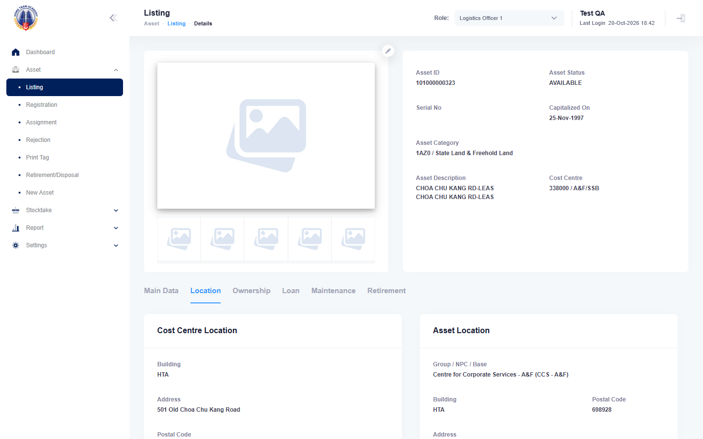

# Run report: mha-mobile / playwright / staging-hta

| Field | Value |
|---|---|
| Result | **FAIL (1 failed)** |
| Run | 2026-10-20_1811_staging-hta_playwright |
| Runner | playwright |
| Base URL | https://mhauatwebhta.southeastasia.cloudapp.azure.com/ |
| Started | 2026-10-20 18:11 |
| Duration | 5m 52s |

## Summary

| Total | Pass | Fail | Flaky | Blocked | Skipped |
|---:|---:|---:|---:|---:|---:|
| 2 | 1 | 1 | 0 | 0 | 0 |

## Results

| ID | Title | Status | Checks | Time | Notes | Evidence |
|---|---|---|---|---|---|---|
| MHM-006 | search asset shows the same asset data as mha web | fail | 71/73 | 3m 11s | test-issue; attempt 2 | [1](screenshots/MHM-006-a1-1.png) [2](traces/MHM-006-a1-3.zip) [3](screenshots/MHM-006-a2-1.png) [4](traces/MHM-006-a2-3.zip) |
| MHM-013 | asset registration completes a progress asset from the phone | pass | 85/85 | 2m 32s | - | - |

## Failures and warnings

### MHM-006: search asset shows the same asset data as mha web (fail)

- Failure type: test-issue
- Source: `projects/mha-mobile/tests/e2e/asset/search-asset.spec.ts`
- Failed: Step: Location equals MHA web (actual: `ExpectError: Expected "-", but received ""`)
- Failed: Step: expect.toBe() (actual: `ExpectError: Expected "-", but received ""`)
- Error: ExpectError: Expected "-", but received ""
- Earlier attempt: fail (failed: Step: Location equals MHA web; Step: expect.toBe())
- Note: empty block/level/room: web "-" vs phone ""; compared with blankable(); passes in 2026-10-20_1817

## Notes

Playwright project "mha-mobile". Full Playwright HTML report: reports/playwright-html/index.html, open with npm run report (overwritten by the next run).
