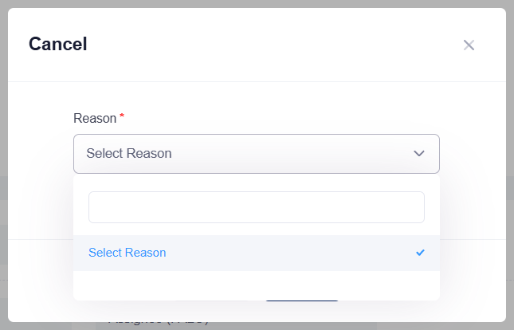

## Summary
On a CREATED ad hoc stocktake, the Cancel dialog's Reason dropdown lists only "Select Reason" and one blank option (value OTHER, empty text). Users cannot see or pick a reason, so Submit keeps saying "Reason is required" and the stocktake cannot be cancelled.

## Steps to reproduce
1. Log in as SPF-A2216GA, switch the role to Logistics Officer 1.
2. Stocktake > Ad Hoc Setup > Create: Periodic, Manual, any name, Recurrence MONTHLY, keep tomorrow as Start Date, Next, tick one asset, Next, Submit.
3. Open the new ADST number from Ad Hoc Setup (status CREATED) and click Cancel.
4. Open the Reason dropdown.
5. Click Submit.

## Expected
The dropdown lists readable reasons (e.g. "Others", as in the other Cancel/Reject dialogs) and picking one shows the mandatory Remarks box, then "Stocktake Ad Hoc has been cancelled.".

## Actual
The dropdown shows "Select Reason" and one empty row (<option value="OTHER"></option>). Submit shows "Reason is required". Setting the hidden select to OTHER by script shows Remarks and the cancel succeeds ("Stocktake Ad Hoc has been cancelled."), so only the option label is missing. Seen on ADST00000005 and ADST00000012.

## Evidence
- Screenshot: 
- DOM: select[name=Reason] in #modal_cancel has options "" = "Select Reason" and "OTHER" = ""

## Environment
- Base URL: https://mhauatweb.southeastasia.cloudapp.azure.com/Stocktake/StocktakeForm?stktakeId=<id>
- Env: staging

## History
- 2026-10-06: filed from exploratory session 2026-10-06 (Aside) in the Test Manager app.
