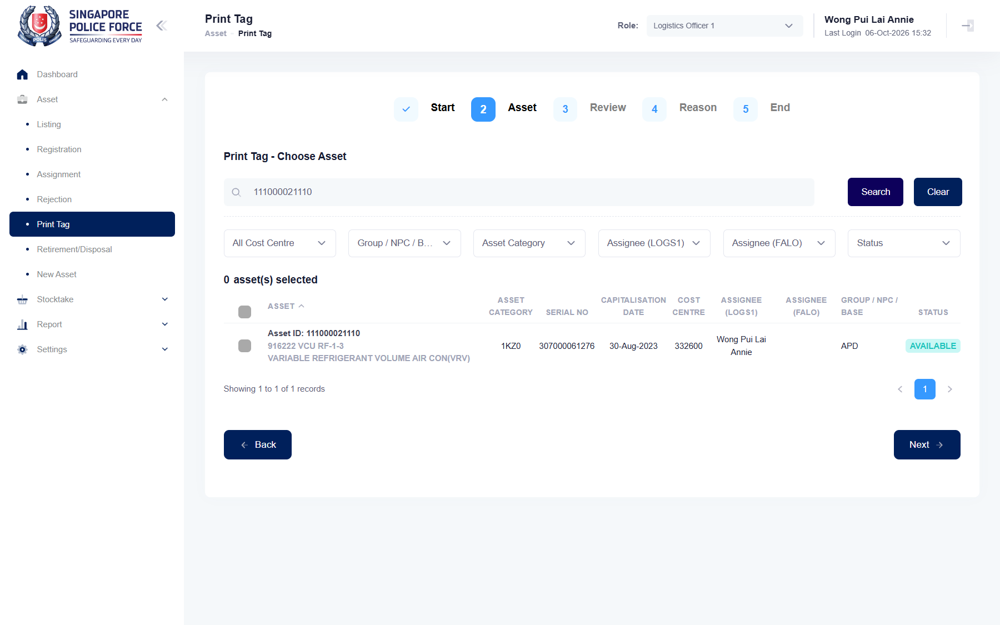

## Summary
Step 2 (Choose Asset) of Asset > Print Tag lists every asset of the unit (2,737, the same as Asset Listing), including assets registered without a tag (Tag Type NA). The user manual says the step lists only assets whose tag type is ASSET or FILE.

## Steps to reproduce
1. Log in as SPF-A2216GA, switch the role to Logistics Officer 1
2. Asset > Listing: open 111000021102 (registered with RFID Tag = No); Main Data shows Tag Type NA
3. Asset > Print Tag > Reprint RFID Tag > Next
4. Search 111000021102

## Expected
The asset is not offered: the manual (Print Tag, step 2) says "The 2nd step will display the list of assets which the tag type is either ASSET or FILE".

## Actual
The asset is listed and can be selected for reprinting ("Showing 1 to 1 of 1 records"). Same for 111000021110 (Tag Type NA). The list total equals the Asset Listing total (2,737).

## Evidence
- Screenshot: 

## Environment
- Base URL: https://mhauatweb.southeastasia.cloudapp.azure.com/Asset/PrintTag
- Env: staging

## History
- 2026-10-06: filed from explorations/2026-10-06-uncovered-flows.md in the Test Manager app.
- 2026-10-06: status open -> wont-fix.
- 2026-10-07: follow-through: SPF-029 notes and context.md call NA assets in Choose Asset accepted behavior; the planned "Print Tag offers only ASSET/FILE assets" test is dropped. No linked tests.
