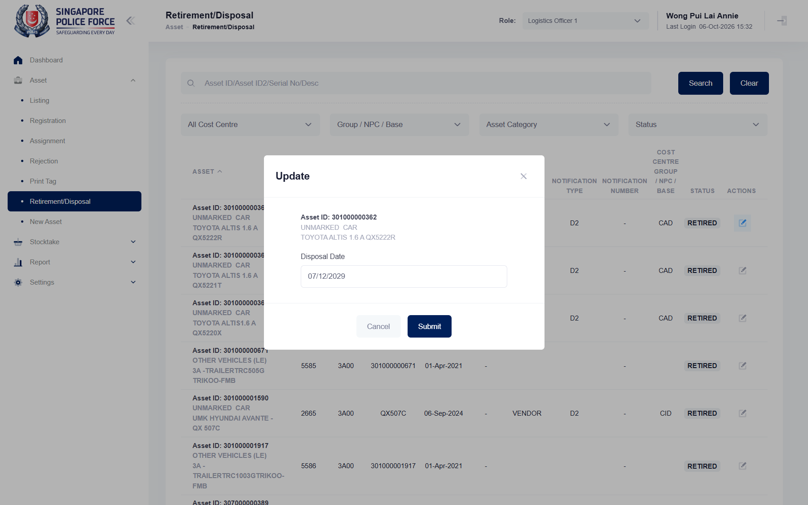

## Summary
After a disposal date is saved, opening the pencil again pre-fills the date field with a different date: day and month are read the wrong way round and the month overflows (31/12/2027 read as month 31). Submitting the dialog without touching the date saves the wrong date, so a RETIRED asset could be disposed on the wrong day.

## Steps to reproduce
1. Log in as SPF-A2216GA, switch the role to Logistics Officer 1
2. Asset > Retirement/Disposal: pencil on the first RETIRED asset with no disposal date (301000000362)
3. Pick 31 Dec 2027 and Submit ("Updating done"); the row shows Disposal Date 31-Dec-2027
4. Click the same pencil again

## Expected
The Disposal Date field shows the saved date, 12/31/2027.

## Actual
The field shows 07/12/2029 (reproduced twice). The date was cleared again afterwards (empty Submit, "Updating done").

## Evidence
- Screenshot: 

## Environment
- Base URL: https://mhauatweb.southeastasia.cloudapp.azure.com/Asset/Retirement
- Env: staging

## History
- 2026-10-06: filed from explorations/2026-10-06-uncovered-flows.md in the Test Manager app.
- 2026-10-06: status open -> wont-fix.
- 2026-10-06: wont-fix accepted: reopening the Update dialog pre-fills a different date. SPF-032 no longer checks the pre-filled value; it now covers changing an existing disposal date (always picking the date).
