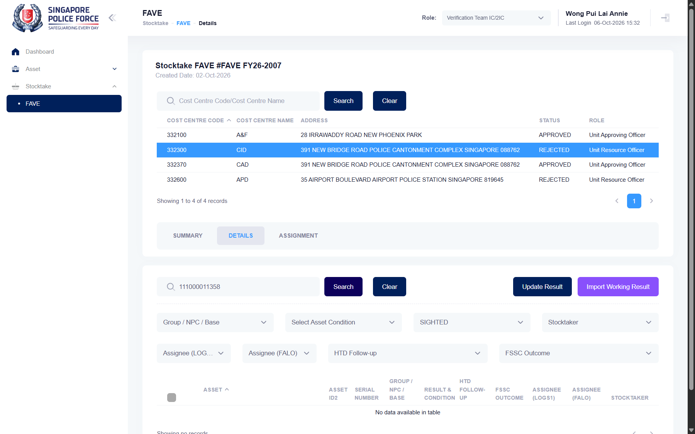

## Summary
Importing a working-result file (header LMSAssetID, one asset ID per row) reports success, but the asset ends up with an empty result: Result & Condition, HTD Follow-up and FSSC Outcome are blank, it is no longer PENDING and the Result = SIGHTED filter does not find it. The manual says imported assets are set to Sighted with condition Working.

## Steps to reproduce
1. Log in as SPF-A2216GA, switch the role to Verification Team IC/2IC
2. Stocktake > FAVE, open FAVE FY26-2007, pick 332300 CID, Details tab; asset 111000011358 is PENDING
3. Import Working Result > Excel file: an .xlsx with A1 "LMSAssetID" and A2 111000011358 (tried as text and as a number); the dialog lists row 1 / 111000011358
4. Import ("The import record(s) have been successful."), then search 111000011358

## Expected
The asset shows SIGHTED / WORKING, HTD Follow-up "No Further Action", FSSC Outcome "Working condition" (manual: "Sighting results will be defaulted to Sighted and condition will be defaulted to Working").

## Actual
Result & Condition, HTD Follow-up and FSSC Outcome are empty; Update Result opens with nothing selected; filtering Result = SIGHTED shows no records. Same after a full reload and on a second import. The asset was set back to PENDING with Update Result afterwards.

## Evidence
- Screenshot: 

## Environment
- Base URL: https://mhauatweb.southeastasia.cloudapp.azure.com/Stocktake/FaveForm?stktakeFAVEId=<id>
- Env: staging

## History
- 2026-10-06: filed from explorations/2026-10-06-uncovered-flows.md in the Test Manager app.
