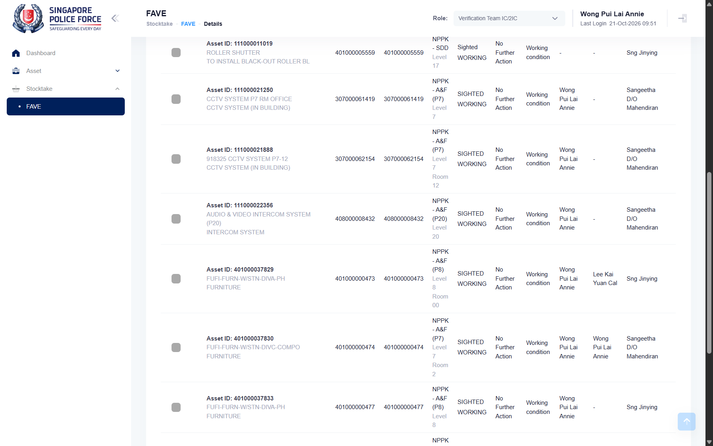
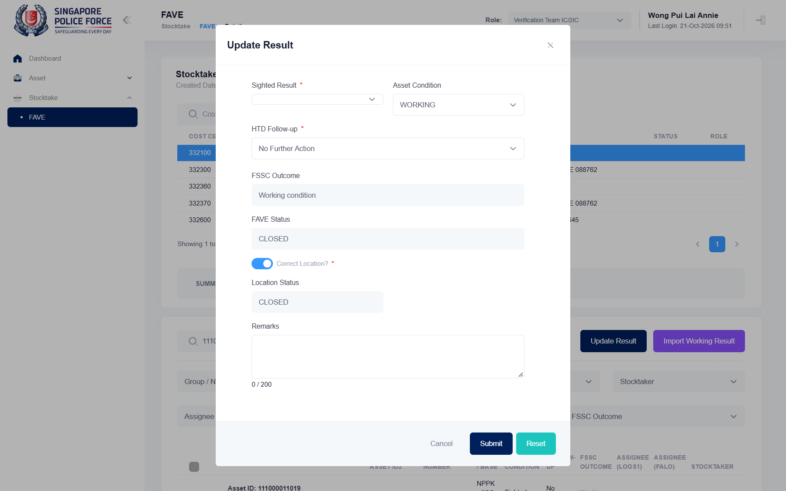

## Summary
Importing a working-result file (header LMSAssetID, one asset ID per row) is meant to set each asset to Sighted / Working (manual). Since the developer's fix (retest 2026-10-21) the import records the result, but saves the Sighted Result as "Sighted" instead of the code SIGHTED that Update Result saves: the row reads "Sighted WORKING" and Update Result opens with no Sighted Result selected. Before the fix (2026-10-06) the import cleared the result completely.

## Steps to reproduce
1. Log in as SPF-A2216GA, switch the role to Verification Team IC/2IC
2. Stocktake > FAVE, open FAVE FY26-2007, pick 332300 CID, Details tab; asset 111000011358 is PENDING
3. Import Working Result > Excel file: an .xlsx with A1 "LMSAssetID" and A2 111000011358 (tried as text and as a number); the dialog lists row 1 / 111000011358
4. Import ("The import record(s) have been successful."), then search 111000011358
5. Tick the asset and click Update Result

Retest 2026-10-21: FAVE FY26-2001, cost centre 332100 A&F, asset 111000011019 (asset ID typed as a number).

## Expected
The asset shows SIGHTED / WORKING, HTD Follow-up "No Further Action", FSSC Outcome "Working condition" (manual: "Sighting results will be defaulted to Sighted and condition will be defaulted to Working"), exactly like a result saved with Update Result: Update Result opens pre-loaded with Sighted Result SIGHTED and Asset Condition WORKING.

## Actual
Retest 2026-10-21 (after the developer's fix):
- Fixed: HTD Follow-up "No Further Action" and FSSC Outcome "Working condition" are filled; the Summary moves the asset from PENDING to SIGHTED / WORKING / No Further Action / Working condition (11 -> 10, 386 -> 387); the Result = SIGHTED filter finds it.
- Still wrong: Result & Condition reads "Sighted" / "WORKING", while every asset saved with Update Result reads "SIGHTED" / "WORKING". Update Result on the imported asset shows Asset Condition WORKING, HTD Follow-up No Further Action, FSSC Outcome Working condition, FAVE Status and Location Status CLOSED, but the mandatory Sighted Result is empty: its select has value "" (options SIGHTED, NOT SIGHTED, PENDING), so the saved "Sighted" matches no option.
- The asset was set back to PENDING with Update Result afterwards.

Before the fix (2026-10-06): Result & Condition, HTD Follow-up and FSSC Outcome were empty; Update Result opened with nothing selected; filtering Result = SIGHTED showed no records. Same after a full reload and on a second import.

## Evidence
- Retest 2026-10-21, imported asset 111000011019 reads "Sighted" above rows saved with Update Result ("SIGHTED"): 
- Retest 2026-10-21, Update Result on the imported asset, Sighted Result empty: 
- Retest run: runs/2026-10-21_0851_staging_playwright (SPF-036: expected substring "SIGHTED", received "Sighted WORKING")
- 2026-10-06, before the fix: 

## Environment
- Base URL: https://mhauatweb.southeastasia.cloudapp.azure.com/Stocktake/FaveForm?stktakeFAVEId=<id>
- Env: staging

## History
- 2026-10-06: filed from explorations/2026-10-06-uncovered-flows.md in the Test Manager app.
- 2026-10-21: status open -> fixed; developer reports it fixed (told by the user); SPF-036 no longer expects the failure (test.fail removed, case notes updated) and now starts the asset from PENDING so an earlier result cannot make it pass.
- 2026-10-21: status fixed -> open; retest after the developer's fix (runs/2026-10-21_0851_staging_playwright, SPF-036 failed on both attempts; repeated by hand on 332100 / 111000011019): partly fixed. The import now fills Result & Condition, HTD Follow-up "No Further Action" and FSSC Outcome "Working condition", the Summary counts the asset under SIGHTED / WORKING and the Result = SIGHTED filter finds it, but the result is saved as "Sighted" (manual results show SIGHTED): the row reads "Sighted WORKING" and Update Result opens with an empty Sighted Result (select value "", options SIGHTED / NOT SIGHTED / PENDING). Reopened; title was "FAVE: Import Working Result clears the sighting result instead of setting Sighted / Working". SPF-036 expects the failure again and now also checks the Update Result pre-load.
- 2026-10-21: status open -> fixed; developer reports the remaining part fixed (told by the user); SPF-036 no longer expects the failure (test.fail removed, case notes updated).
- 2026-10-21: status fixed -> verified; retest passed in runs/2026-10-21_0949_staging_playwright (SPF-036, first attempt, all 63 checks; 332100 / 111000011019): after the import the row reads SIGHTED / WORKING, No Further Action, Working condition, and Update Result pre-loads Sighted Result SIGHTED, Asset Condition WORKING, HTD Follow-up No Further Action, FSSC Outcome Working condition, FAVE Status and Location Status CLOSED, the same as a result saved by hand. SPF-036 keeps checking it.
