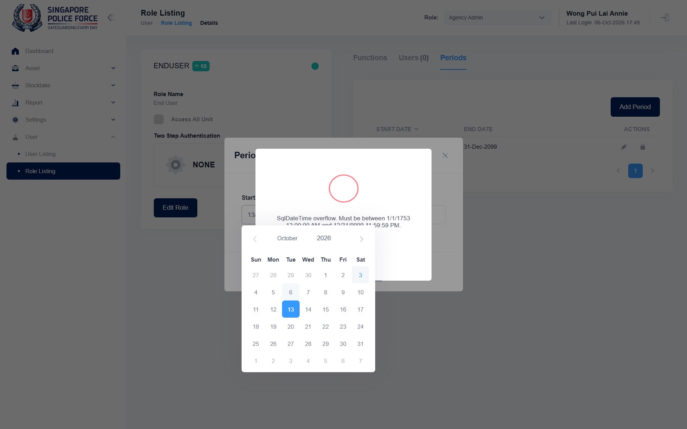

## Summary
The Add Period dialog picks dates as dd/mm/yyyy, but the server reads them as mm/dd/yyyy. Dates with a day up to 12 are saved with day and month swapped; any day above 12 is rejected with a raw database error. Role validity periods (used to switch VET IC and Stocktaker roles on and off for FAVE) cannot be set correctly, and a wrong period can make a role unusable.

## Steps to reproduce
1. Log in as the test account, role Agency Admin
2. User > Role Listing, pencil of End User (any role), tab Periods, Add Period
3. Pick Start Date 13 of the current month and End Date 20 of the current month in the calendar (fields show 13/10/2026 and 20/10/2026), Submit
4. Add Period again, pick Start Date 2 Nov 2026 and End Date 3 Dec 2026 (02/11/2026, 03/12/2026), Submit
5. Look at the Periods table, then delete the new row

## Expected
Both periods are saved with the picked dates ("Period has been successfully saved."), e.g. 02-Nov-2026 to 03-Dec-2026.

## Actual
Step 3: "SqlDateTime overflow. Must be between 1/1/1753 12:00:00 AM and 12/31/9999 11:59:59 PM." and nothing is saved. Step 4: "Period has been successfully saved." but the table shows 11-Feb-2026 to 12-Mar-2026. Editing an existing period opens with its dates in dd/mm/yyyy (e.g. 21/03/2023), so saving it again would fail the same way.

## Evidence
- Screenshot: 
- Screenshot: 
- Reproduced with calendar clicks and with the date picker API (same result)

## Environment
- Base URL: https://mhauatweb.southeastasia.cloudapp.azure.com/User/Role
- Env: staging

## History
- 2026-10-06: filed from explorations/2026-10-06-admin.md in the Test Manager app.
