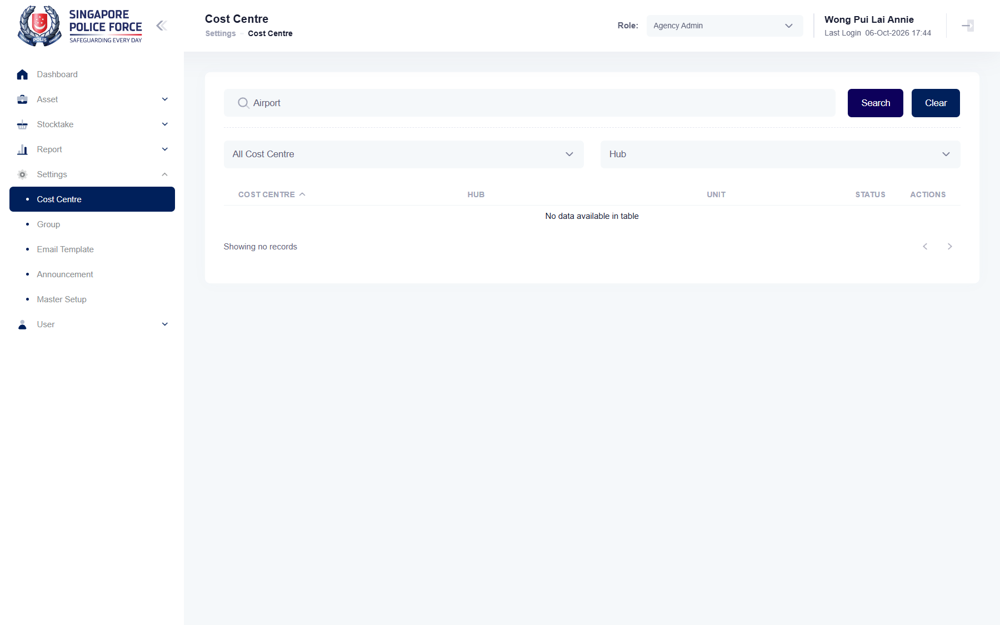

## Summary
The keyword box says "Cost Centre Code/Cost Centre Desc", but only the code and the short name match. Searching a description returns no records.

## Steps to reproduce
1. Log in as the test account, role Agency Admin
2. Settings > Cost Centre: the list shows 332600 APD (description "Airport Police Department" on its form)
3. Type Airport (or "Airport Police Department", or "Administration" for 332100 A&F) in the keyword box, Search

## Expected
The cost centre whose description contains the text is listed (placeholder "Cost Centre Code/Cost Centre Desc").

## Actual
"Showing no records" (GetList returns []). Searching 332600 or APD finds it.

## Evidence
- Screenshot: 

## Environment
- Base URL: https://mhauatweb.southeastasia.cloudapp.azure.com/Setting/CostCenter
- Env: staging

## History
- 2026-10-06: filed from explorations/2026-10-06-admin.md in the Test Manager app.
