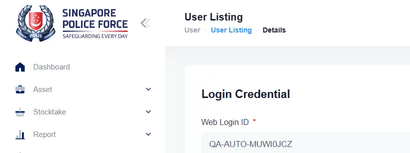

## Summary
Removing a user from a role in Role Listing keeps an EXPIRED entry that the user form lists with empty Code and Name, and the tab count still includes it.

## Steps to reproduce
1. As Agency Admin, User > Role Listing > End User > Users > Add User, tick a user (e.g. a "QA auto user"), Submit
2. Delete the user from the role (trash icon): "End User role has been removed from User <name>."
3. User > User Listing, search the user, pencil, tab Roles

## Expected
The removed role is not listed (Roles(0)), or it is listed with its code and name (ENDUSER, End User) and status EXPIRED.

## Actual
Tab "Roles(1)" with one row: Code and Name empty, status EXPIRED.

## Evidence
- Screenshot: 

## Environment
- Base URL: https://mhauatweb.southeastasia.cloudapp.azure.com/User/User
- Env: staging

## History
- 2026-10-06: filed from explorations/2026-10-06-admin.md in the Test Manager app.
