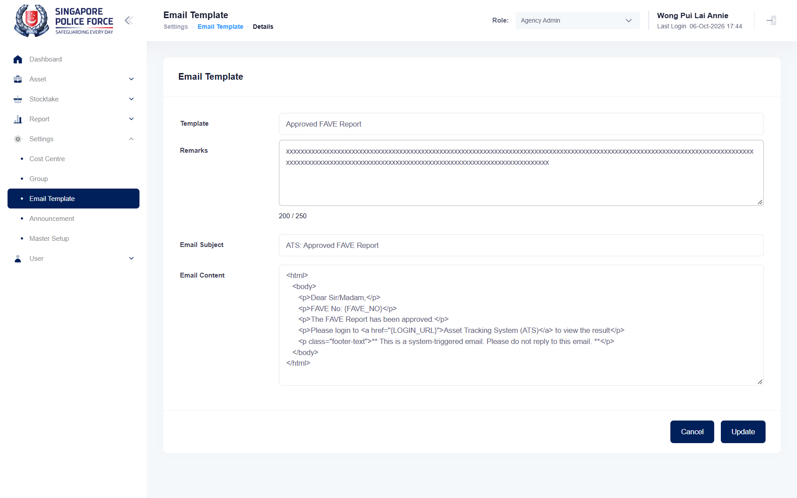

## Summary
The Remarks counter under the field reads "0 / 200" when empty but "<n> / 250" as soon as there is text (also on load); the field stops at 200 characters.

## Steps to reproduce
1. As Agency Admin, Settings > Email Template, pencil of any template
2. Type in Remarks, or paste 230 characters

## Expected
The counter shows "/ 200" (maxlength 200) at all times.

## Actual
"14 / 250" after typing 14 characters; "200 / 250" after pasting 230 (the field keeps 200).

## Evidence
- Screenshot: 

## Environment
- Base URL: https://mhauatweb.southeastasia.cloudapp.azure.com/Setting/EmailTemplate
- Env: staging

## History
- 2026-10-06: filed from explorations/2026-10-06-admin.md in the Test Manager app.
