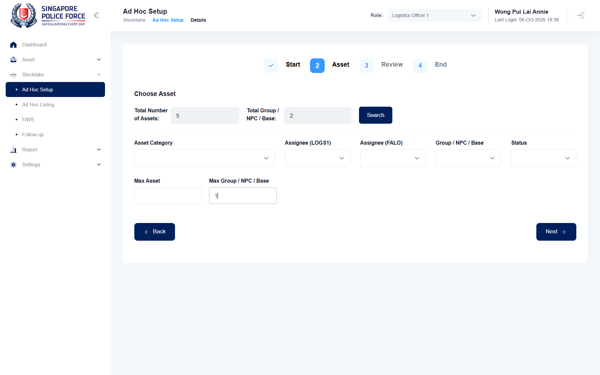

## Summary
With Asset Selection Random, the Choose Asset search sometimes returns assets from one group more than Max Group / NPC / Base allows. The extra group is an asset that has no Group / NPC / Base (e.g. 602000017251917228, ASSET TRACKING SYSTEM, AVAILABLE, LOGS1 Wong Pui Lai Annie). With Max Group 1, that asset alone is often the whole pick (1 asset, 1 group).

## Steps to reproduce
1. Log in as the test account, role Logistics Officer 1
2. Stocktake > Ad Hoc Setup > Create; Periodic, Random, any name, Recurrence Type MONTHLY, Next
3. Leave every filter empty, type Max Group / NPC / Base 1 (or 2), click Search several times and read Total Group / NPC / Base
4. Next: the Review list shows the picked assets and their Group / NPC / Base

## Expected
Total Group / NPC / Base is never more than Max Group / NPC / Base, and the Review assets come from at most that many groups.

## Actual
Max Group 1: 7 searches gave 1 asset / 1 group (the no-group asset) six times and 34 assets / 2 groups once (33 from NPPK - A&F (P20) plus the no-group asset); another try gave 5 assets / 2 groups. Max Group 2: 3 of 9 searches gave 3 groups (e.g. 36 assets: 33 NPPK - A&F (P20), 2 NPPK - SDD, 1 with an empty group).

## Evidence
- Screenshot (Max Group 1, Total Group 2): 

## Environment
- Base URL: https://mhauatweb.southeastasia.cloudapp.azure.com/Stocktake/StocktakeCreate
- Env: staging

## History
- 2026-10-07: filed from SPF-053 exploration 2026-10-07 in the Test Manager app.
