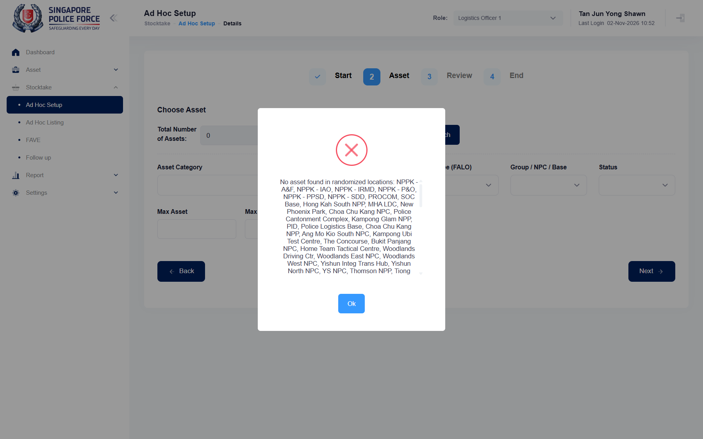

## Question
Is it expected that Ad Hoc Setup > Create finds no asset at all for this account (Manual: 'No data available in table'; Random: 'No asset found in randomized locations: ...'), although Asset Listing shows it 2,462 assets as Logistics Officer 1? If ad hoc only works for one unit, or only for assets assigned to the user, which account or unit should the ad hoc tests use?

## Context
Seen 2026-11-02 on UAT. The test account in .env is now a different login (4 units: HTX, A&F, APD, VSC) than the one used on 2026-10-06 (SPF-A2216GA), when SPF-023 created setups fine. Today the Choose Asset step is empty with no filter set, both Manual (also after Search) and Random (Search gives Total Number of Assets 0). Ad Hoc Setup lists only setups of another officer (Wong Pui Lai Annie, cost centre 332100). SPF-022, SPF-023 and SPF-053 all start by creating a setup, so they cannot get past the create step. Answer decides: product bug (file it) or test data (give the account a unit / use another account).

## Evidence
- Screenshot: 
- SPF-023 in runs/2026-11-02_0951_staging_playwright stops at step 1-2 (firstAssetId: '#tbSearch tbody tr' has no 'Asset ID:')

## Answer
Not answered yet.

## History
- 2026-11-02: asked from runs/2026-11-02_0951_staging_playwright.
