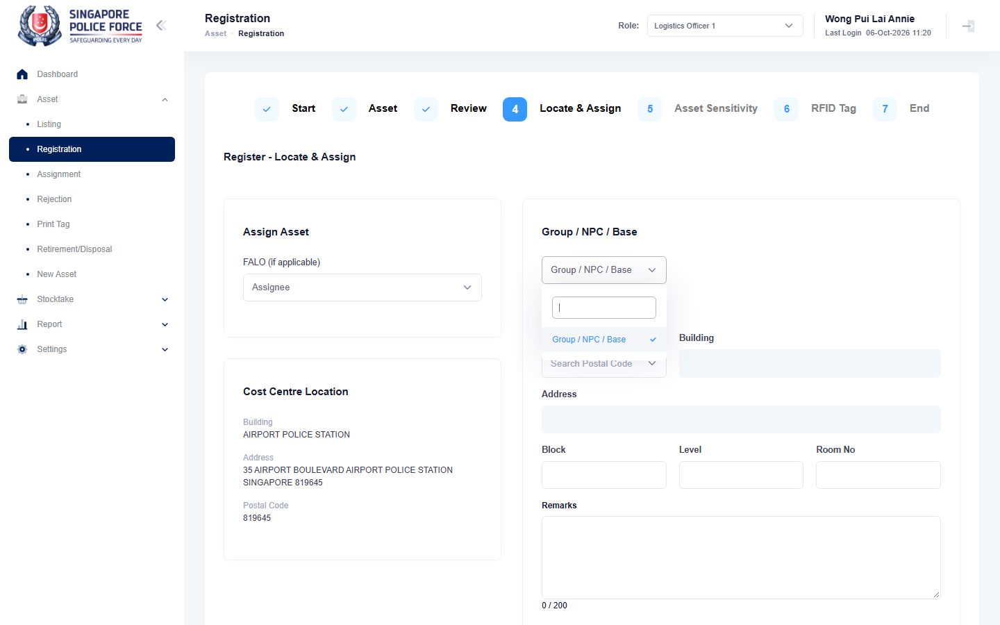

# Run report: mha-spf / playwright / staging

| Field | Value |
|---|---|
| Result | **PASS** |
| Run | 2026-10-06_1021_staging_playwright |
| Runner | playwright |
| Base URL | https://mhauatweb.southeastasia.cloudapp.azure.com/ |
| Started | 2026-10-06 10:21 |
| Duration | 3m 25s |

## Summary

| Total | Pass | Fail | Flaky | Blocked | Skipped |
|---:|---:|---:|---:|---:|---:|
| 17 | 16 | 0 | 1 | 0 | 0 |

## Results

| ID | Title | Status | Checks | Time | Notes | Evidence |
|---|---|---|---|---|---|---|
| SPF-001 | log in with the passwordless test account | pass | 23/23 | 2.1s | - | - |
| SPF-002 | switch the active role from the header role dropdown | pass | 19/19 | 5.1s | - | - |
| SPF-003 | log out ends access to protected pages | pass | 10/10 | 4.9s | - | - |
| SPF-004 | logs1 finds an asset by asset id in asset listing | pass | 14/14 | 5.5s | - | - |
| SPF-005 | logs1 filters asset listing by status | pass | 16/16 | 6.0s | - | - |
| SPF-006 | asset details show the asset header and the data tabs | pass | 31/31 | 5.7s | - | - |
| SPF-007 | logs1 walks the relocate wizard up to the location step | pass | 29/29 | 6.3s | - | - |
| SPF-008 | logs1 relocates an asset and the relocation is auto-approved | pass | 40/40 | 14.9s | - | - |
| SPF-009 | logs1 assigns an asset to a falo and it is auto-approved | pass | 38/38 | 13.9s | - | - |
| SPF-010 | falo returns an asset to logs1 and logs1 approves it | pass | 71/71 | 24.8s | - | - |
| SPF-011 | logs1 rejects a falo return with a reason | pass | 53/53 | 19.4s | - | - |
| SPF-012 | owner cancels a submitted assignment with a reason | pass | 49/49 | 15.0s | - | - |
| SPF-013 | logs1 registers a new asset with a complete location | pass | 27/27 | 10.8s | - | - |
| SPF-014 | partial registration sets progress and complete register finishes it | flaky | 43/43 | 38.5s | attempt 2 | [1](screenshots/SPF-014-a1-1.png) [2](traces/SPF-014-a1-3.zip) |
| SPF-015 | reject a new asset from registration and reinstate it | pass | 32/32 | 9.4s | - | - |
| SPF-016 | report a potential new asset and close it as logs1 | pass | 39/39 | 9.6s | - | - |
| SPF-017 | report a potential new asset and cancel it | pass | 29/29 | 11.9s | - | - |

## Failures and warnings

### SPF-014: partial registration sets progress and complete register finishes it (flaky)

- Source: `projects/mha-spf/tests/e2e/asset-registration/registration.spec.ts`
- Earlier attempt: fail (failed: Step: 1. Register 111000021105 without block/level/room/remarks)

## Notes

Playwright project "mha-spf". Full Playwright HTML report: reports/playwright-html/index.html, open with npm run report (overwritten by the next run).
