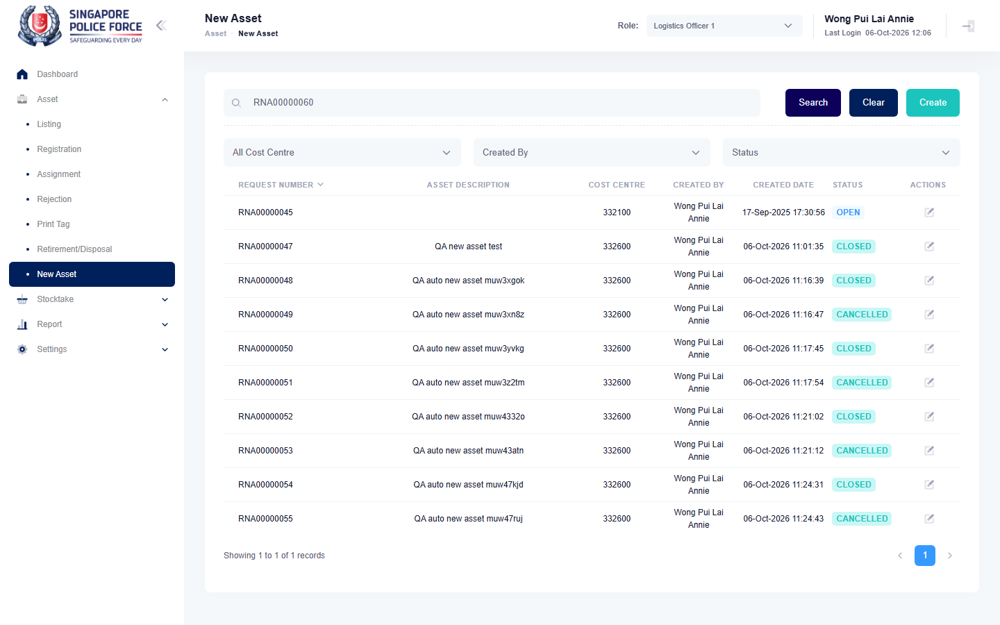

# Run report: mha-spf / playwright / staging

| Field | Value |
|---|---|
| Result | **PASS** |
| Run | 2026-10-06_1102_staging_playwright |
| Runner | playwright |
| Base URL | https://mhauatweb.southeastasia.cloudapp.azure.com/ |
| Started | 2026-10-06 11:02 |
| Duration | 3m 56s |

## Summary

| Total | Pass | Fail | Flaky | Blocked | Skipped |
|---:|---:|---:|---:|---:|---:|
| 18 | 17 | 0 | 1 | 0 | 0 |

## Results

| ID | Title | Status | Checks | Time | Notes | Evidence |
|---|---|---|---|---|---|---|
| SPF-001 | log in with the passwordless test account | pass | 23/23 | 3.0s | - | - |
| SPF-002 | switch the active role from the header role dropdown | pass | 19/19 | 5.6s | - | - |
| SPF-003 | log out ends access to protected pages | pass | 10/10 | 5.4s | - | - |
| SPF-004 | logs1 finds an asset by asset id in asset listing | pass | 14/14 | 4.8s | - | - |
| SPF-005 | logs1 filters asset listing by status | pass | 17/17 | 7.0s | - | - |
| SPF-006 | asset details show the asset header and the data tabs | pass | 31/31 | 5.6s | - | - |
| SPF-007 | logs1 walks the relocate wizard up to the location step | pass | 29/29 | 7.9s | - | - |
| SPF-008 | logs1 relocates an asset and the relocation is auto-approved | pass | 42/42 | 16.2s | - | - |
| SPF-009 | logs1 assigns an asset to a falo and it is auto-approved | pass | 42/42 | 14.7s | - | - |
| SPF-010 | falo returns an asset to logs1 and logs1 approves it | pass | 78/78 | 28.0s | - | - |
| SPF-011 | logs1 rejects a falo return with a reason | pass | 60/60 | 23.2s | - | - |
| SPF-012 | owner cancels a submitted assignment with a reason | pass | 54/54 | 16.5s | - | - |
| SPF-013 | logs1 registers a new asset with a complete location | pass | 29/29 | 11.9s | - | - |
| SPF-014 | partial registration sets progress and complete register finishes it | pass | 45/45 | 14.6s | - | - |
| SPF-015 | reject a new asset from registration and reinstate it | pass | 34/34 | 10.4s | - | - |
| SPF-016 | report a potential new asset and close it as logs1 | flaky | 42/42 | 26.0s | attempt 2 | [1](screenshots/SPF-016-a1-1.png) [2](traces/SPF-016-a1-3.zip) |
| SPF-017 | report a potential new asset and cancel it | pass | 32/32 | 7.9s | - | - |
| SPF-018 | logs1 recalls an asset from another falo and the uro approval clears the falo | pass | 79/79 | 25.8s | - | - |

## Failures and warnings

### SPF-016: report a potential new asset and close it as logs1 (flaky)

- Source: `projects/mha-spf/tests/e2e/new-asset/new-asset.spec.ts`
- Earlier attempt: fail (failed: Step: 5. Listed as OPEN with Close and Cancel actions; Expect "toHaveCount")

## Notes

Playwright project "mha-spf". Full Playwright HTML report: reports/playwright-html/index.html, open with npm run report (overwritten by the next run).
