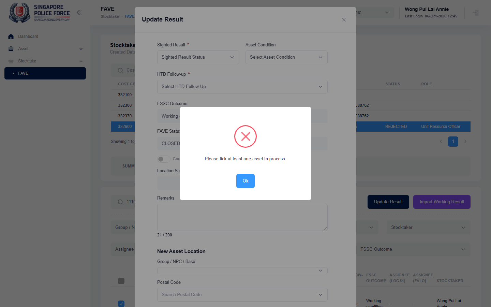

# Run report: mha-spf / playwright / staging

| Field | Value |
|---|---|
| Result | **FAIL (1 failed)** |
| Run | 2026-10-06_1153_staging_playwright |
| Runner | playwright |
| Base URL | https://mhauatweb.southeastasia.cloudapp.azure.com/ |
| Started | 2026-10-06 11:53 |
| Duration | 1m 45s |

## Summary

| Total | Pass | Fail | Flaky | Blocked | Skipped |
|---:|---:|---:|---:|---:|---:|
| 5 | 4 | 1 | 0 | 0 | 0 |

## Results

| ID | Title | Status | Checks | Time | Notes | Evidence |
|---|---|---|---|---|---|---|
| SPF-019 | vet ic views the active fave for a unit and exports it | pass | 32/32 | 5.9s | - | - |
| SPF-020 | vet ic updates a fave sighting result and htd follow-up is auto-mapped | fail | 53/55 | 17.0s | untriaged | [1](screenshots/SPF-020-a1-1.png) [2](traces/SPF-020-a1-3.zip) |
| SPF-021 | vet ic assigns a stocktaker to a fave asset | pass | 49/49 | 14.7s | - | - |
| SPF-025 | vet ic submits the unit fave and uro rejects it back with a reason | pass | 80/80 | 29.8s | - | - |
| SPF-026 | fave goes from vet ic through uro to uao, and uao rejects it back to uro | pass | 80/80 | 35.8s | - | - |

## Failures and warnings

### SPF-020: vet ic updates a fave sighting result and htd follow-up is auto-mapped (fail)

- Failure type: untriaged
- Source: `projects/mha-spf/tests/e2e/stocktake-fave/fave.spec.ts`
- Failed: Step: 5. Single selection pre-loads the saved values; PENDING resets the result (actual: `Error: expect(locator).toHaveText(expected) failed  Locator:  locator('#modal_result').locator('[id^="select2-SightedResult-"][id$="-container"]')`)
- Failed: Expect "toHaveText" (actual: `Error: expect(locator).toHaveText(expected) failed  Locator:  locator('#modal_result').locator('[id^="select2-SightedResult-"][id$="-container"]')`)
- Error: Error: expect(locator).toHaveText(expected) failed  Locator:  locator('#modal_result').locator('[id^="select2-SightedResult-"][id$="-container"]') Expected: "SIGHTED" Received: "Sighted Result Status" Timeout:  5000ms  Call log:   - Expect "toHaveText" locator('#modal_result').locator('[id^="select2-SightedResult-"][id$="-container"]') with timeout 5000ms   - waiting for locator('#modal_result').…

## Notes

Playwright project "mha-spf". Full Playwright HTML report: reports/playwright-html/index.html, open with npm run report (overwritten by the next run).
