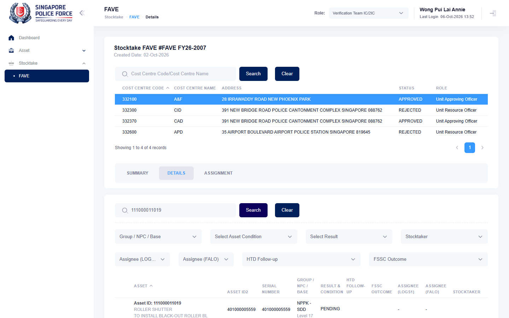

# Run report: mha-spf / playwright / staging

| Field | Value |
|---|---|
| Result | **FAIL (2 failed)** |
| Run | 2026-10-06_1255_staging_playwright |
| Runner | playwright |
| Base URL | https://mhauatweb.southeastasia.cloudapp.azure.com/ |
| Started | 2026-10-06 12:55 |
| Duration | 6m 26s |

## Summary

| Total | Pass | Fail | Flaky | Blocked | Skipped |
|---:|---:|---:|---:|---:|---:|
| 18 | 16 | 2 | 0 | 0 | 0 |

## Results

| ID | Title | Status | Checks | Time | Notes | Evidence |
|---|---|---|---|---|---|---|
| SPF-013 | logs1 registers a new asset with a complete location | pass | 31/31 | 21.3s | - | - |
| SPF-013 | logs1 registers a new asset with a complete location | pass | 31/31 | 17.1s | - | - |
| SPF-014 | partial registration sets progress and complete register finishes it | pass | 47/47 | 15.2s | - | - |
| SPF-014 | partial registration sets progress and complete register finishes it | pass | 47/47 | 15.4s | - | - |
| SPF-016 | report a potential new asset and close it as logs1 | pass | 47/47 | 9.7s | - | - |
| SPF-016 | report a potential new asset and close it as logs1 | pass | 47/47 | 9.4s | - | - |
| SPF-017 | report a potential new asset and cancel it | pass | 36/36 | 8.6s | - | - |
| SPF-017 | report a potential new asset and cancel it | pass | 36/36 | 8.6s | - | - |
| SPF-019 | vet ic views the active fave for a unit and exports it | fail | 27/29 | 9.8s | untriaged | [1](screenshots/SPF-019-a1-1.png) [2](traces/SPF-019-a1-3.zip) |
| SPF-019 | vet ic views the active fave for a unit and exports it | fail | 27/29 | 9.7s | untriaged | [1](screenshots/SPF-019-a1-1.png) [2](traces/SPF-019-a1-3.zip) |
| SPF-020 | vet ic updates a fave sighting result and htd follow-up is auto-mapped | pass | 70/70 | 26.2s | - | - |
| SPF-020 | vet ic updates a fave sighting result and htd follow-up is auto-mapped | pass | 70/70 | 26.5s | - | - |
| SPF-021 | vet ic assigns a stocktaker to a fave asset | pass | 54/54 | 22.1s | - | - |
| SPF-021 | vet ic assigns a stocktaker to a fave asset | pass | 54/54 | 23.0s | - | - |
| SPF-025 | vet ic submits the unit fave and uro rejects it back with a reason | pass | 80/80 | 36.9s | - | - |
| SPF-025 | vet ic submits the unit fave and uro rejects it back with a reason | pass | 80/80 | 35.1s | - | - |
| SPF-026 | fave goes from vet ic through uro to uao, and uao rejects it back to uro | pass | 80/80 | 44.6s | - | - |
| SPF-026 | fave goes from vet ic through uro to uao, and uao rejects it back to uro | pass | 80/80 | 43.5s | - | - |

## Failures and warnings

### SPF-019: vet ic views the active fave for a unit and exports it (fail)

- Failure type: untriaged
- Source: `projects/mha-spf/tests/e2e/stocktake-fave/fave.spec.ts`
- Failed: Step: 4. Details search finds the asset with a sighting result (actual: `Error: expect(locator).toHaveText(expected) failed  Locator: locator('#tbdetail tbody tr').filter({ hasText: 'Asset ID: 111000011019' }).locator('td').nth(6)`)
- Failed: Expect "toHaveText" (actual: `Error: expect(locator).toHaveText(expected) failed  Locator: locator('#tbdetail tbody tr').filter({ hasText: 'Asset ID: 111000011019' }).locator('td').nth(6)`)
- Error: Error: expect(locator).toHaveText(expected) failed  Locator: locator('#tbdetail tbody tr').filter({ hasText: 'Asset ID: 111000011019' }).locator('td').nth(6) Expected pattern: /^\s*(PENDING|SIGHTED|NOT SIGHTED)\b/ Received string:  "" Timeout: 5000ms  Call log:   - Expect "toHaveText" locator('#tbdetail tbody tr').filter({ hasText: 'Asset ID: 111000011019' }).locator('td').nth(6) with timeout 500…

### SPF-019: vet ic views the active fave for a unit and exports it (fail)

- Failure type: untriaged
- Source: `projects/mha-spf/tests/e2e/stocktake-fave/fave.spec.ts`
- Failed: Step: 4. Details search finds the asset with a sighting result (actual: `Error: expect(locator).toHaveText(expected) failed  Locator: locator('#tbdetail tbody tr').filter({ hasText: 'Asset ID: 111000011019' }).locator('td').nth(6)`)
- Failed: Expect "toHaveText" (actual: `Error: expect(locator).toHaveText(expected) failed  Locator: locator('#tbdetail tbody tr').filter({ hasText: 'Asset ID: 111000011019' }).locator('td').nth(6)`)
- Error: Error: expect(locator).toHaveText(expected) failed  Locator: locator('#tbdetail tbody tr').filter({ hasText: 'Asset ID: 111000011019' }).locator('td').nth(6) Expected pattern: /^\s*(PENDING|SIGHTED|NOT SIGHTED)\b/ Received string:  "" Timeout: 5000ms  Call log:   - Expect "toHaveText" locator('#tbdetail tbody tr').filter({ hasText: 'Asset ID: 111000011019' }).locator('td').nth(6) with timeout 500…

## Notes

Playwright project "mha-spf". Full Playwright HTML report: reports/playwright-html/index.html, open with npm run report (overwritten by the next run).
