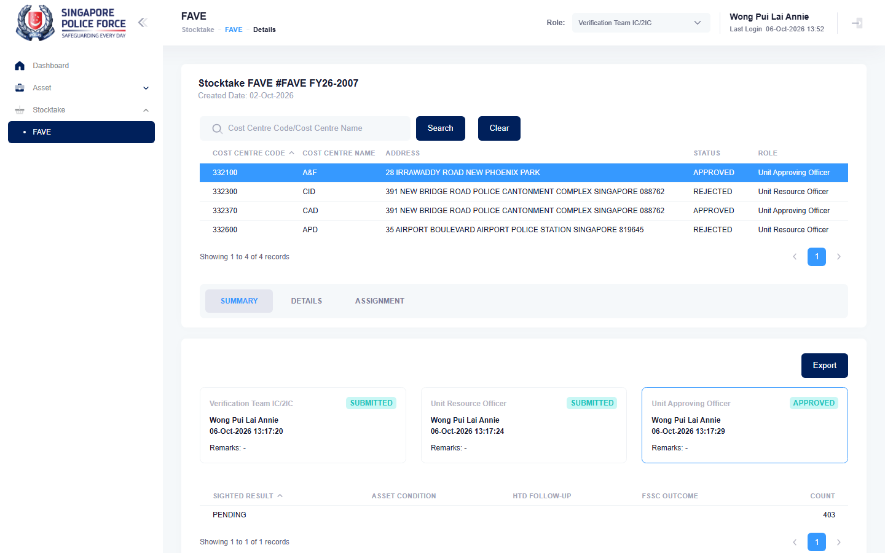

# Run report: mha-spf / playwright / staging

| Field | Value |
|---|---|
| Result | **FAIL (2 failed)** |
| Run | 2026-10-06_1309_staging_playwright |
| Runner | playwright |
| Base URL | https://mhauatweb.southeastasia.cloudapp.azure.com/ |
| Started | 2026-10-06 13:09 |
| Duration | 25.9s |

## Summary

| Total | Pass | Fail | Flaky | Blocked | Skipped |
|---:|---:|---:|---:|---:|---:|
| 2 | 0 | 2 | 0 | 0 | 0 |

## Results

| ID | Title | Status | Checks | Time | Notes | Evidence |
|---|---|---|---|---|---|---|
| SPF-019 | vet ic views the active fave for a unit and exports it | fail | 14/16 | 13.3s | untriaged | [1](screenshots/SPF-019-a1-1.png) [2](traces/SPF-019-a1-3.zip) |
| SPF-019 | vet ic views the active fave for a unit and exports it | fail | 14/16 | 11.3s | untriaged | [1](screenshots/SPF-019-a1-1.png) [2](traces/SPF-019-a1-3.zip) |

## Failures and warnings

### SPF-019: vet ic views the active fave for a unit and exports it (fail)

- Failure type: untriaged
- Source: `projects/mha-spf/tests/e2e/stocktake-fave/fave.spec.ts`
- Failed: Step: 1. Open the first FAVE and take a cost centre that is not approved (actual: `Error: expect(locator).toContainText(expected) failed  Locator: getByRole('heading', { name: /^Stocktake (FAVE|No) #/, level: 1 })`)
- Failed: Expect "toContainText" (actual: `Error: expect(locator).toContainText(expected) failed  Locator: getByRole('heading', { name: /^Stocktake (FAVE|No) #/, level: 1 })`)
- Error: Error: expect(locator).toContainText(expected) failed  Locator: getByRole('heading', { name: /^Stocktake (FAVE|No) #/, level: 1 }) Timeout: 5000ms Expected pattern: /^Stocktake FAVE #FAVE FY\d{2}-20\d{2}/ Received string:  "                     Stocktake FAVE #FAVE FY26-2007                     Created Date: 02-Oct-2026                 "  Call log:   - Expect "toContainText" getByRole('heading', …

### SPF-019: vet ic views the active fave for a unit and exports it (fail)

- Failure type: untriaged
- Source: `projects/mha-spf/tests/e2e/stocktake-fave/fave.spec.ts`
- Failed: Step: 1. Open the first FAVE and take a cost centre that is not approved (actual: `Error: expect(locator).toContainText(expected) failed  Locator: getByRole('heading', { name: /^Stocktake (FAVE|No) #/, level: 1 })`)
- Failed: Expect "toContainText" (actual: `Error: expect(locator).toContainText(expected) failed  Locator: getByRole('heading', { name: /^Stocktake (FAVE|No) #/, level: 1 })`)
- Error: Error: expect(locator).toContainText(expected) failed  Locator: getByRole('heading', { name: /^Stocktake (FAVE|No) #/, level: 1 }) Timeout: 5000ms Expected pattern: /^Stocktake FAVE #FAVE FY\d{2}-20\d{2}/ Received string:  "                     Stocktake FAVE #FAVE FY26-2007                     Created Date: 02-Oct-2026                 "  Call log:   - Expect "toContainText" getByRole('heading', …

## Notes

Playwright project "mha-spf". Full Playwright HTML report: reports/playwright-html/index.html, open with npm run report (overwritten by the next run).
