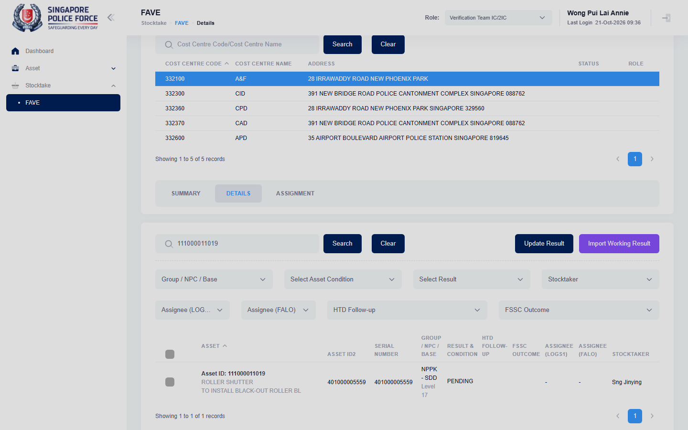

# Run report: mha-spf / playwright / staging

| Field | Value |
|---|---|
| Result | **FAIL (1 failed)** |
| Run | 2026-10-21_0851_staging_playwright |
| Runner | playwright |
| Base URL | https://mhauatweb.southeastasia.cloudapp.azure.com/ |
| Started | 2026-10-21 08:51 |
| Duration | 1m 8s |

## Summary

| Total | Pass | Fail | Flaky | Blocked | Skipped |
|---:|---:|---:|---:|---:|---:|
| 1 | 0 | 1 | 0 | 0 | 0 |

## Results

| ID | Title | Status | Checks | Time | Notes | Evidence |
|---|---|---|---|---|---|---|
| SPF-036 | vet ic imports a working result file and the assets become sighted / working | fail | 51/53 | 1m 5s | product-bug; BUG-007; attempt 2 | [1](screenshots/SPF-036-a1-1.png) [2](traces/SPF-036-a1-3.zip) [3](screenshots/SPF-036-a2-1.png) [4](traces/SPF-036-a2-3.zip) |

## Failures and warnings

### SPF-036: vet ic imports a working result file and the assets become sighted / working (fail)

- Failure type: product-bug (bug BUG-007)
- Source: `projects/mha-spf/tests/e2e/stocktake-fave/fave-import.spec.ts`
- Failed: Step: 4. The asset is SIGHTED / WORKING with the FSSC mapping (actual: `Error: expect(locator).toContainText(expected) failed  Locator: locator('#tbdetail tbody tr').filter({ hasText: 'Asset ID: 111000011019' }).locator('xpath=td[count(ancestor::table[1]/thead//th[normal…`)
- Failed: Expect "toContainText" (actual: `Error: expect(locator).toContainText(expected) failed  Locator: locator('#tbdetail tbody tr').filter({ hasText: 'Asset ID: 111000011019' }).locator('xpath=td[count(ancestor::table[1]/thead//th[normal…`)
- Error: Error: expect(locator).toContainText(expected) failed  Locator: locator('#tbdetail tbody tr').filter({ hasText: 'Asset ID: 111000011019' }).locator('xpath=td[count(ancestor::table[1]/thead//th[normalize-space()="Result & Condition"]/preceding-sibling::th)+1]') Timeout: 5000ms - Expected substring  - 1 + Received string     + 4  - SIGHTED + +                                 Sighted +              …
- Earlier attempt: fail (failed: Step: 4. The asset is SIGHTED / WORKING with the FSSC mapping; Expect "toContainText")
- Note: Retest of the BUG-007 fix: the import now sets "Sighted WORKING" / No Further Action / Working condition, but saves "Sighted" instead of SIGHTED; by hand Update Result opens with no Sighted Result. BUG-007 reopened (partly fixed)

## Notes

Playwright project "mha-spf". Full Playwright HTML report: reports/playwright-html/index.html, open with npm run report (overwritten by the next run).
