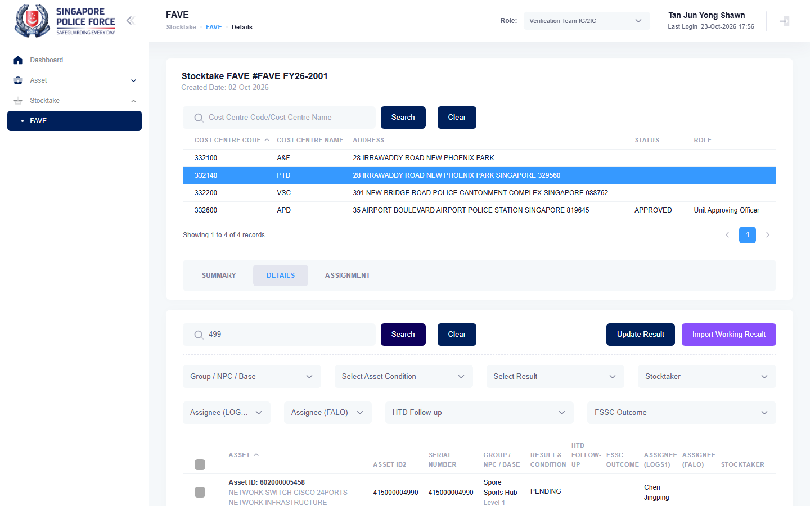

# Run report: mha-spf / bug-007-htx-332140-499 / staging

| Field | Value |
|---|---|
| Result | **FAIL (1 failed)** |
| Run | 2026-10-23_1656_staging_playwright |
| Runner | playwright |
| Base URL | https://mhauatweb.southeastasia.cloudapp.azure.com/ |
| Started | 2026-10-23 16:56 |
| Duration | 1m 17s |

## Summary

| Total | Pass | Fail | Flaky | Blocked | Skipped |
|---:|---:|---:|---:|---:|---:|
| 1 | 0 | 1 | 0 | 0 | 0 |

## Results

| ID | Title | Status | Checks | Time | Notes | Evidence |
|---|---|---|---|---|---|---|
| SPF-036 | vet ic imports a working result file and the assets become sighted / working | fail | 20/23 | 1m 14s | environment; attempt 2 | [1](screenshots/SPF-036-a1-1.png) [2](traces/SPF-036-a1-3.zip) [3](screenshots/SPF-036-a2-1.png) [4](traces/SPF-036-a2-3.zip) |

## Failures and warnings

### SPF-036: vet ic imports a working result file and the assets become sighted / working (fail)

- Failure type: environment
- Source: `projects/mha-spf/tests/e2e/stocktake-fave/fave-import.spec.ts`
- Failed: Step: 1-2. Open the FAVE on 332140 with 499 PENDING, choose a file with 499 (actual: `Error: expect(locator).toHaveCount(expected) failed  Locator:  locator('#tbdetail tbody tr').filter({ hasText: 'Asset ID: 499' })`)
- Failed: Expect "toHaveCount" (actual: `Error: expect(locator).toHaveCount(expected) failed  Locator:  locator('#tbdetail tbody tr').filter({ hasText: 'Asset ID: 499' })`)
- Failed: Expect "toHaveCount" (actual: `Error: expect(locator).toHaveCount(expected) failed  Locator:  locator('#tbdetail tbody tr').filter({ hasText: 'Asset ID: 499' })`)
- Error: Error: expect(locator).toHaveCount(expected) failed  Locator:  locator('#tbdetail tbody tr').filter({ hasText: 'Asset ID: 499' }) Expected: 1 Received: 0 Timeout:  5000ms  Call log:   - Expect "toHaveCount" locator('#tbdetail tbody tr').filter({ hasText: 'Asset ID: 499' }) with timeout 5000ms   - waiting for locator('#tbdetail tbody tr').filter({ hasText: 'Asset ID: 499' })     14 × locator resol…
- Earlier attempt: fail (failed: Step: 1-2. Open the FAVE on 332140 with 499 PENDING, choose a file with 499; Expect "toHaveCount"; Expect "toHaveCount")
- Note: Asset ID 499 did not appear in the FAVE Details search for requested cost centre 332140 on FAVE FY26-2001; the import was not reached.

## Notes

Playwright project "mha-spf". Full Playwright HTML report: reports/playwright-html/index.html, open with npm run report (overwritten by the next run).
