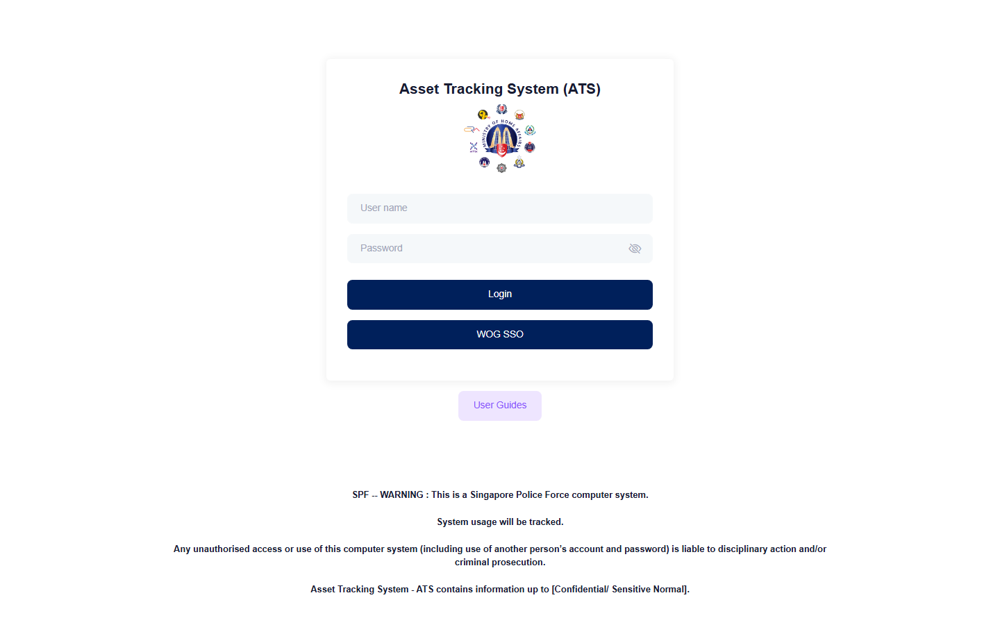

# Run report: mha-spf / bug-retest / staging

| Field | Value |
|---|---|
| Result | **FAIL (1 failed)** |
| Run | 2026-11-02_1000_staging_playwright |
| Runner | playwright |
| Base URL | https://mhauatweb.southeastasia.cloudapp.azure.com/ |
| Started | 2026-11-02 10:00 |
| Duration | 2m 13s |

## Summary

| Total | Pass | Fail | Flaky | Blocked | Skipped |
|---:|---:|---:|---:|---:|---:|
| 1 | 0 | 1 | 0 | 0 | 0 |

## Results

| ID | Title | Status | Checks | Time | Notes | Evidence |
|---|---|---|---|---|---|---|
| SPF-048 | role period is saved with the dates picked in the calendar | fail | 2/4 | 2m 12s | environment; attempt 2 | [1](screenshots/SPF-048-a1-1.png) [2](traces/SPF-048-a1-3.zip) [3](screenshots/SPF-048-a2-1.png) [4](traces/SPF-048-a2-3.zip) |

## Failures and warnings

### SPF-048: role period is saved with the dates picked in the calendar (fail)

- Failure type: environment
- Source: `projects/mha-spf/tests/e2e/user-admin/role-periods.spec.ts`
- Failed: Expect "toHaveText" (actual: `Error: expect(locator).toHaveText(expected) failed  Locator: locator('#tblist_info')`)
- Failed: Expect "toHaveText" (actual: `Error: expect(locator).toHaveText(expected) failed  Locator: locator('#tblist_info')`)
- Error: Error: expect(locator).toHaveText(expected) failed  Locator: locator('#tblist_info') Expected pattern: /Showing \d/ Timeout: 30000ms Error: element(s) not found  Call log:   - Expect "toHaveText" locator('#tblist_info') with timeout 30000ms   - waiting for locator('#tblist_info') 
- Earlier attempt: fail (failed: Expect "toHaveText"; Expect "toHaveText")
- Note: Same stale saved session as runs/2026-11-02_0958 (manual login in Aside's browser); rerun with QA_AUTH_MAX_AGE_MIN=0

## Notes

Playwright project "mha-spf". Full Playwright HTML report: reports/playwright-html/index.html, open with npm run report (overwritten by the next run).
