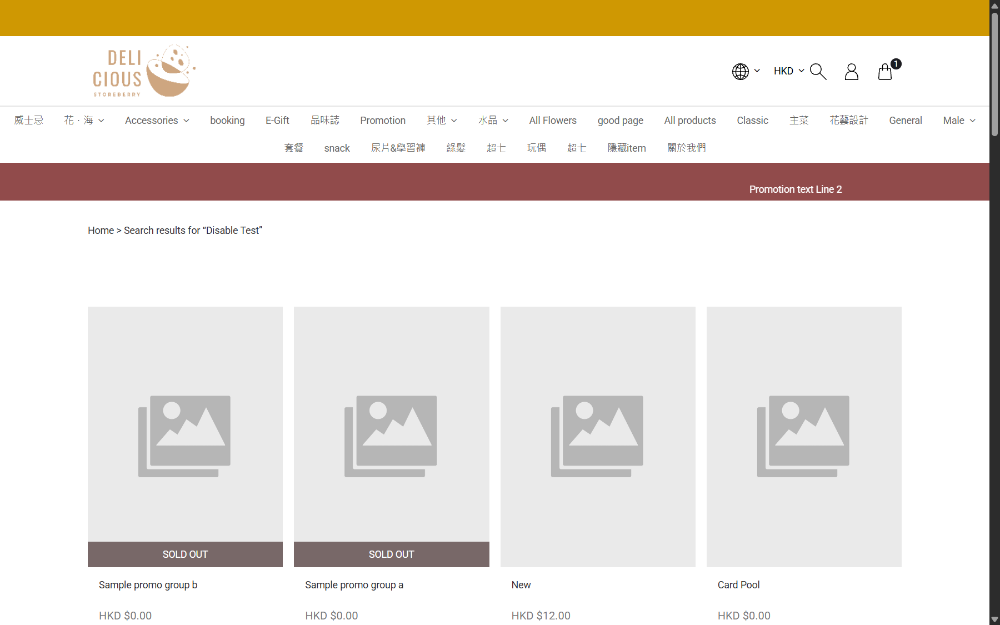

## Summary
Searching for Disable Test on staging repeatedly returns a page of unrelated products instead of the matching product. The same query on the published online store returns Disable Test.

## Steps to reproduce
1. Open the staging storefront home page.
2. Search for Disable Test and submit the search.
3. Review the displayed search results.

## Expected
The result set should contain products matching Disable Test; the known listed product Disable Test should be returned.

## Actual
The results page heading shows the query Disable Test, but the results include unrelated products such as Sample promo group b, New, Card Pool, and Shoes C, and do not include Disable Test.

## Evidence
- Screenshot: 
- Production comparison: the same query on the linked live storefront returned Disable Test at HKD .00.

## Environment
- Base URL: https://storeberry-flower.stagingl10.storeberry.xyz/product/search?q=Disable+Test
- Env: staging

## History
- 2026-10-23: filed from explorations/2026-10-23-storefront-search.md in the Test Manager app.
- 2026-10-27: Retested in explorations/2026-10-27-eshop-critical.md: still reproduces; the query is ignored entirely - "Shoesss", "偈油x10" and the nonsense "zzqxnotexist123" all return the same 24 products, none matching.
- 2026-10-27: status open -> fixed.
- 2026-10-27: status fixed -> verified.
- 2026-10-27: SBF-003 note updated: must pass.
