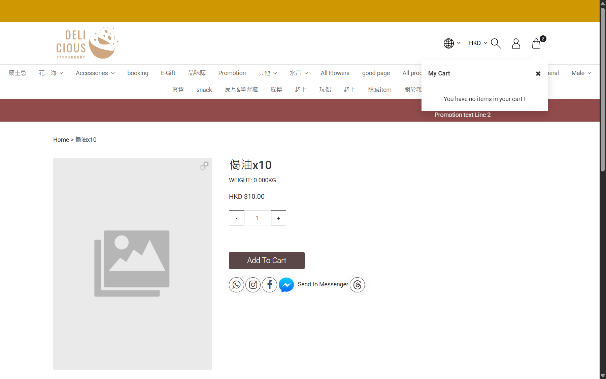

## Summary
Adding an available product reports success and increments the header cart badge, but the cart drawer contains no line items. After reload the count remains elevated and the drawer can remain on a loading spinner.

## Steps to reproduce
1. Open the staging product page for 偈油x10 (HKD 10.00) in a guest session.
2. Click Add To Cart once.
3. Confirm the toast says Item added successfully and the header cart badge increments.
4. Open the header cart drawer.
5. Reload and open the cart drawer again.

## Expected
The cart drawer shows 偈油x10 with quantity 1 and its HKD 10.00 price; after reload the line remains visible.

## Actual
The toast says Item added successfully and the badge increments, but the drawer says You have no items in your cart !. After reload, the badge remains elevated and the drawer shows a loading spinner instead of the item.

## Evidence
- Screenshot: 
- No JavaScript console errors or HTTP error responses were observed during the add-to-cart attempt.

## Environment
- Base URL: https://storeberry-flower.stagingl10.storeberry.xyz/products/%E5%81%88%E6%B2%B9x10
- Env: staging

## History
- 2026-10-23: filed from explorations/2026-10-23-cart-follow-up.md in the Test Manager app.
- 2026-10-27: Retested in explorations/2026-10-27-eshop-critical.md: not reproduced - adding 偈油x10 qty 2 showed the line (HKD 20.00) in the drawer and it persisted after reload. Left open for the user to set fixed/verified.
- 2026-10-27: status open -> verified.
- 2026-10-27: status verified -> fixed.
- 2026-10-27: fixed: SBF-004 notes updated, the case must now pass.
- 2026-10-27: status fixed -> verified.
- 2026-10-27: SBF-004 note updated: must pass.
