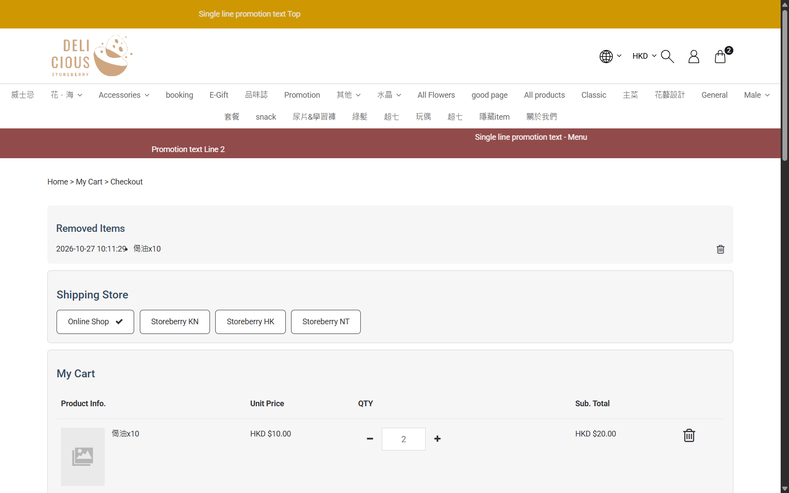

## Summary
The Payment Methods dropdown on checkout lists three options by their i18n key instead of a name, and two methods appear twice with identical labels.

## Steps to reproduce
1. Add any product to the cart and open /checkout
2. Open the Payment Methods dropdown

## Expected
Every option has a readable, unique customer-facing name.

## Actual
Options include "order.checkout_v2.methods.ocu-20000", "order.checkout_v2.methods.fn-allinpay", "order.checkout_v2.methods.aip-alipay"; "FPS" (fn-fps, qf-802001) and "PayMe" (fn-payme, qf-805814) each appear twice.

## Evidence
- Screenshot: 

## Environment
- Base URL: https://storeberry-flower.stagingl10.storeberry.xyz/checkout
- Env: staging

## History
- 2026-10-27: filed from explorations/2026-10-27-eshop-critical.md in the Test Manager app.
- 2026-10-27: Rechecked 2026-10-27 ~11:00 after an apparent deploy: ocu-20000 now shows "Custom1" (still not a real name); "order.checkout_v2.methods.fn-allinpay" and "order.checkout_v2.methods.aip-alipay" still raw; FPS and PayMe still duplicated.
- 2026-10-27: status open -> wont-fix.
- 2026-10-27: wont-fix: SBF-010 updated so raw/duplicate payment labels are accepted behavior; tests emptied.
