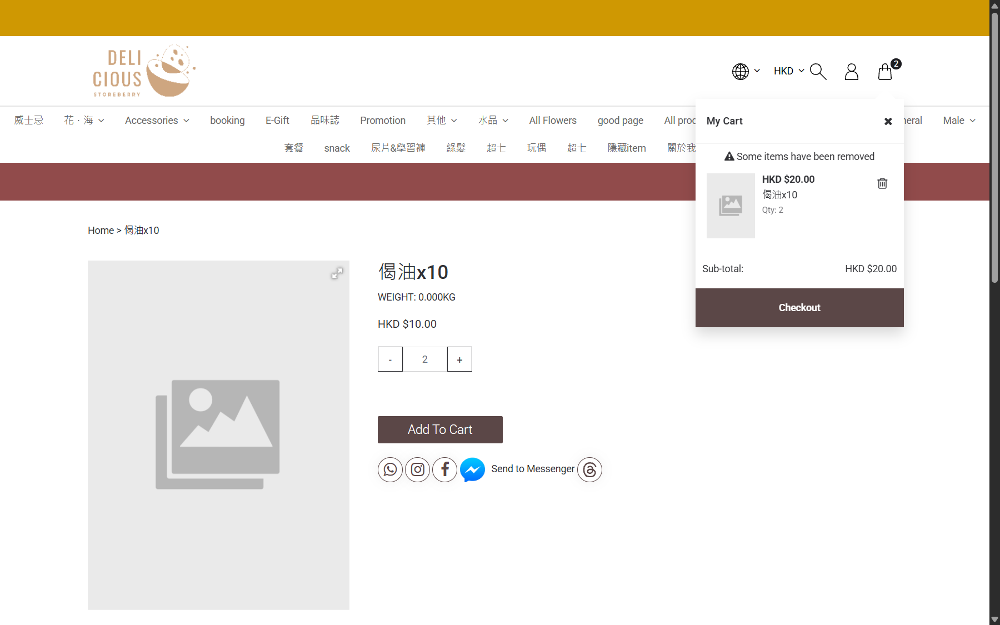

## Summary
A "Some items have been removed" / "Removed Items 2026-10-27 10:11:29 偈油x10" notice stays in the cart drawer and checkout after the same product is re-added. After logging in as a member, the shipping Email field still holds the earlier guest email and reverts to it after reload; the removed promo code stays visible in the promo box.

## Steps to reproduce
1. Have an old guest cart whose item was auto-removed, then re-add 偈油x10
2. Open the cart drawer and /checkout
3. Fill a guest shipping email, then log in as a member and reopen /checkout
4. Apply then REMOVE promo VIP888

## Expected
Removed-items notice clears once acknowledged or the item is back; shipping email uses the member email; promo box clears after REMOVE.

## Actual
Notice persists while the item is in the cart; shipping Email = aside.guest...@example.com for the member (had to be corrected twice); promo box still shows VIP888.

## Evidence
- Screenshot: 

## Environment
- Base URL: https://storeberry-flower.stagingl10.storeberry.xyz/checkout
- Env: staging

## History
- 2026-10-27: filed from explorations/2026-10-27-eshop-critical.md in the Test Manager app.
