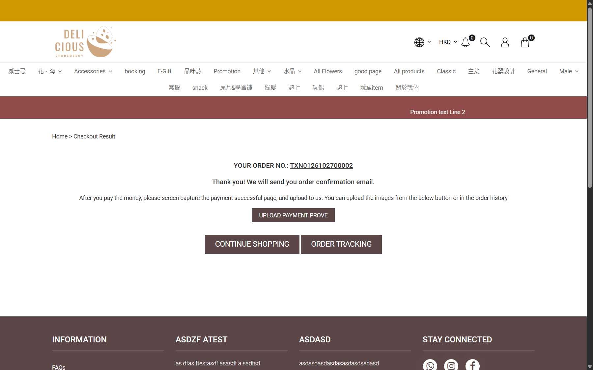

## Summary
Customer-facing spelling errors in checkout.

## Steps to reproduce
1. Checkout heading: "Please leave you gift message to your loved one (Optional)"
2. Thank-you page button: "UPLOAD PAYMENT PROVE"
3. Quota warning: "Member is requried for quota product."

## Expected
"your gift message", "UPLOAD PAYMENT PROOF", "required".

## Actual
As listed.

## Evidence
- Screenshot: 

## Environment
- Base URL: https://storeberry-flower.stagingl10.storeberry.xyz/checkout
- Env: staging

## History
- 2026-10-27: filed from explorations/2026-10-27-eshop-critical.md in the Test Manager app.
