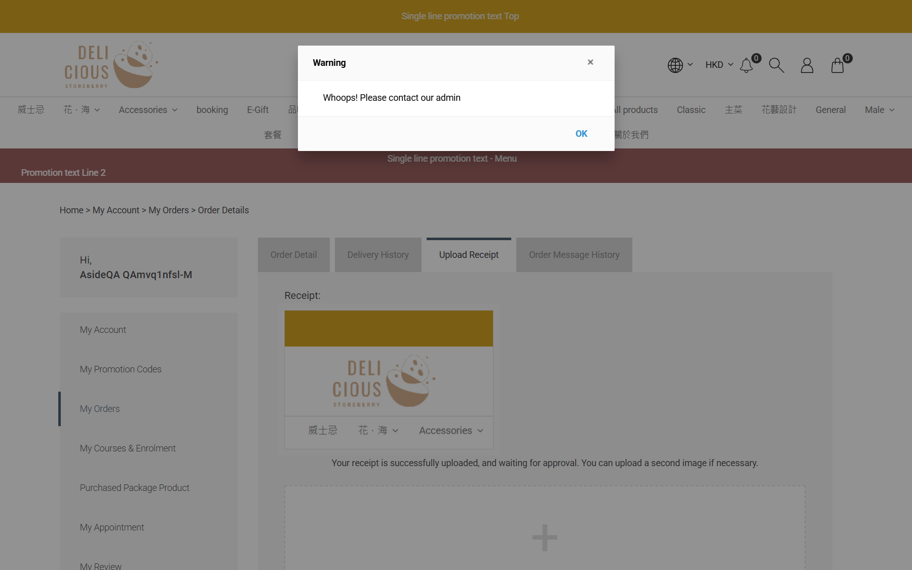

## Summary
For an order that was edited in the CRM (replacement order TXN0126102700002A), uploading a payment receipt shows the receipt and "Your receipt is successfully uploaded, and waiting for approval", but a Warning modal "Whoops! Please contact our admin" opens at the same time. The upload did work (status Payment Review, receipt visible in CRM). For fresh orders (TXN0126102700003/4) the same upload shows no warning.

## Steps to reproduce
1. Edit an order in the CRM (Actions > Edit this order) so a replacement order "...A" is created
2. On the eShop log in as that member, My Orders > the "...A" order > Upload Receipt
3. Choose an image and Submit

## Expected
Only the success message; no error modal.

## Actual
Success text plus modal "Warning - Whoops! Please contact our admin". Customers will think payment proof failed and contact support or re-upload.

## Evidence
- Screenshot: 
- Related CRM bug: receipt accept always fails with the same message.

## Environment
- Base URL: https://storeberry-flower.stagingl10.storeberry.xyz/my-account/orders-detail?txn_key=TXN0126102700002A&tab=order-receipt
- Env: staging

## History
- 2026-10-27: filed from explorations/2026-10-27-eshop-critical.md in the Test Manager app.
