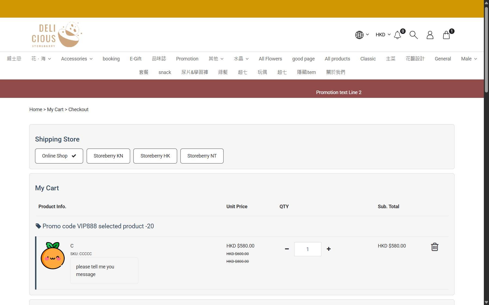

## Summary
After removing product test 2 at checkout (cart drops from HKD 1,260 to 560 net), the "promotion : 0 / 99" add-on block shows 水晶手串1 at HKD 0.00 (was HKD 150), which belongs to the HKD 1,000 "free gift" add-on the cart no longer qualifies for. Clicking it opens the product options (HKD 80) and add-to-cart returns OK with count 2, but no line is added and no message is shown. A reload shows the right add-on products again.

## Steps to reproduce
1. Log in as a member, add C (HKD 600) and product test 2 (HKD 1,000), open /checkout
2. Click the remove icon of product test 2
3. Read the "promotion" add-on block, then click Add to Cart on 水晶手串1, choose 16mm, Add To Cart

## Expected
Add-on block shows promotion 650 Group B items at HKD 100; nothing from promotion 620 is offered.

## Actual
Block shows 水晶手串1 HKD 0.00 / HKD 150.00; adding it silently does nothing (cart stays at 1 item). Reproduced twice; correct after reload.

## Evidence
- Screenshot: 

## Environment
- Base URL: https://storeberry-flower.stagingl10.storeberry.xyz/checkout
- Env: staging

## History
- 2026-10-27: filed from explorations/2026-10-27-cart-payment-review.md in the Test Manager app.
