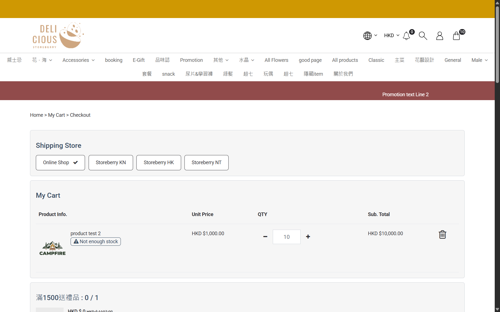

## Summary
The product page and the checkout use different stock limits. Add To Cart allows up to the combined stock of all warehouses linked to Online Shop (Office + TaiPo + IFC Warehouse + 半島倉), but the checkout cart line checks a single warehouse (TaiPo) and shows "Not enough stock" for anything above it. The customer is told the item was added, then finds it unavailable at checkout with no explanation of how many can be bought.

## Steps to reproduce
1. As a guest with an empty cart open product test 2
2. Set quantity **52** and click Add To Cart -> "Item added successfully", badge 52
3. Open /checkout
4. Reduce the line to 8 with the minus button

## Expected
Add To Cart and checkout agree. Either the product page refuses quantities checkout cannot fulfil (with the available number), or checkout accepts what was added.

## Actual
- Step 2: accepted (53 is refused with "Not enough quantity for this product").
- Step 3: the line shows "Not enough stock" (also with qty 9).
- Step 4: the warning disappears at qty 8.
- CRM Inventory at the time: product test 2 Office 44, TaiPo 8, IFC Warehouse 0, 半島倉 0 (Online Shop warehouses, total 52); 68 across all warehouses.
- Not checked: whether Proceed to checkout is then blocked (no order placed).

## Evidence
- Screenshot (2026-10-28, TaiPo 9, qty 10): 
- CRM Inventory > View by Variants, search "product test 2"; Add Transfer Order warehouse list shows which warehouses serve Online Shop.

## Environment
- Base URL: https://storeberry-flower.stagingl10.storeberry.xyz/
- Env: staging

## History
- 2026-10-27: filed from explorations/2026-10-27-promotions-stock.md. Related: Q-009 in storeberry-crm (which warehouse serves online orders); BUG-005 (late quota warning, wont-fix) is a similar "told late" pattern but not the same check.
- 2026-10-28: status open -> wont-fix. SBF-025 now checks only quantities within the TaiPo stock (accepted behavior noted); context.md updated; tests list emptied.
