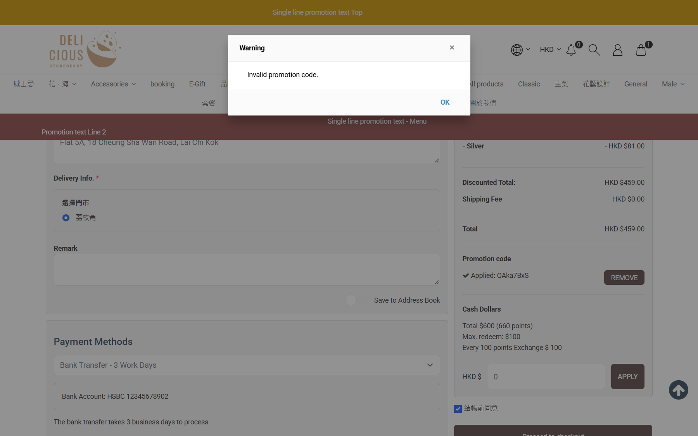

## Summary
When a promotion code that is already applied in the checkout is revoked in the CRM, the checkout keeps showing it as "Applied" with its discount, also after the order is re-priced (shipping method changed). Proceed to checkout then stops with a bare "Invalid promotion code." warning, and after OK the summary still shows the revoked code and the discounted total. Only a page reload removes it. The server does refuse the order (no order is created), so no money is lost, but the customer sees a total they cannot get and is not told which code is invalid or that it was removed.

## Steps to reproduce
1. CRM: Promotions > promotion "Promo Code: Get Y% off with discount code X" with Multiple Promotion Code; generate a code (e.g. promotion 662)
2. eShop (member MEMy001164526): add product C to the cart, open /checkout, apply the code -> "Applied: <code>", Basket Discount -HKD 60.00
3. CRM: Multiple Promotion Code tab > Revoke on that code -> status Revoked
4. eShop: change Shipping Method to 住宅送貨 and back to 門市自取 (re-pricing), fill pickup info, tick 結帳前同意, Proceed to checkout
5. Click OK on the warning

## Expected
Re-pricing drops the revoked code (or Proceed refuses it with a message naming the code) and the summary shows the price without it.

## Actual
Step 4 re-pricing keeps "Applied: <code>" and Total HKD 459.00 (should be 510.00). Proceed shows the modal "Warning / Invalid promotion code." and stays on /checkout. After OK the summary still shows the code and HKD 459.00; reload shows HKD 510.00 without the code. Reproduced twice (QAka7BxS, QBgH2nw9).

## Evidence
- Screenshot: 
- Screenshot: 

## Environment
- Base URL: https://storeberry-flower.stagingl10.storeberry.xyz/checkout
- Env: staging

## History
- 2026-10-28: filed from explorations/2026-10-28-promo-code-orders.md in the Test Manager app.
