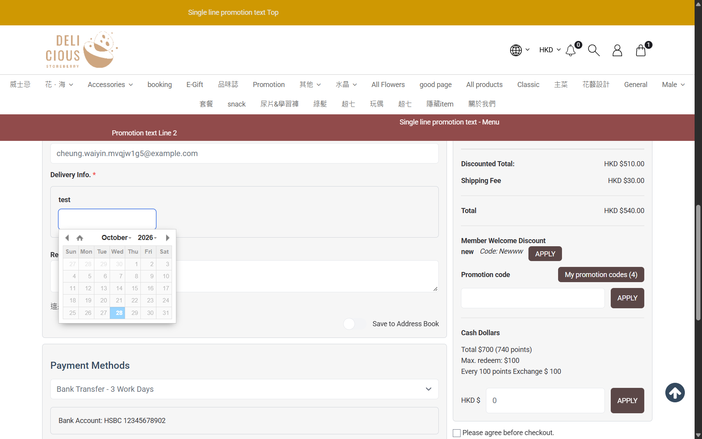

## Summary
The Delivery Info date field of a shipping method is a plain editable text input. The xdsoft picker greys out blocked dates (outside the method's date range, inside its minimum preparation days), but typing a date bypasses it and the server accepts it. Non-date text is silently turned into today's date. A customer can book a delivery the shop said it cannot do (e.g. same-day delivery when 5 preparation days are required).

## Steps to reproduce
1. CRM: Online Store > Shipping > edit method 'Testing' (id 111): Delivery Info date field 'test' with range 2026-09-05 to 2026-09-22 and 'minimum preparation days' 5
2. eShop as member MEMy001164526: add product C, open /checkout, Shipping Method 'Testing'
3. Click the 'test' field: every date in the picker is greyed out (none selectable)
4. Type 'next week please' and press Tab -> the field shows 2026-10-28 (today)
5. Tick 'Please agree before checkout', Proceed to checkout
6. CRM: open the order, Delivery panel

## Expected
Typed values outside the allowed dates (and non-date text) are refused at the field or at Proceed with a message; no order is placed with a blocked delivery date.

## Actual
Order TXN0126102800010 placed (Total HKD 540.00); CRM Delivery Info 'test' = 2026-10-28, the order date itself (5 preparation days required, and outside the 2026-09-05..09-22 range). Typing 2026-12-01 is also kept. A value set without the blur handler was stored as 0001-01-01 (TXN0126102800009). Reproduced twice.

## Evidence
- Screenshot: 
- Screenshot: 

## Environment
- Base URL: https://storeberry-flower.stagingl10.storeberry.xyz/checkout
- Env: staging

## History
- 2026-10-28: filed from explorations/2026-10-28-shipping-fees-last-unit.md in the Test Manager app.
