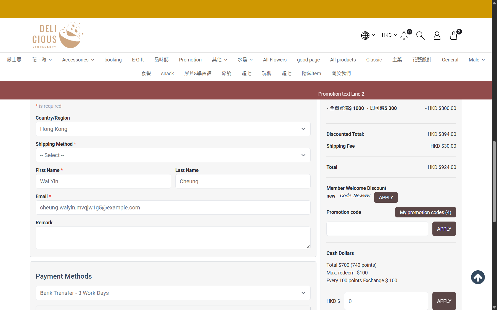

## Summary
When the cart is changed at checkout (quantity - or trash icon), Shipping Method resets to '-- Select --' but the Summary keeps the previous method's Shipping Fee and adds it to Total. The customer sees a delivery charge with no delivery method chosen; picking a method again recomputes it, so no wrong charge was placed.

## Steps to reproduce
1. eShop as member MEMy001164526: add product C x3 (two lines: 2 x 597 'buy 2 6off' and 1 x 600), open /checkout
2. Shipping Method 'Testing' (flat HKD 30, free from HKD 1600) -> Shipping Fee HKD 30.00
3. Click the trash icon of the 1 x C line (or - on a line)
4. Read Shipping Method and the Summary

## Expected
Either the method stays selected and the fee is recomputed, or the method is cleared and Shipping Fee shows '-' with Total = Discounted Total.

## Actual
Shipping Method '-- Select --'; Summary 'Shipping Fee HKD $30.00', Total HKD 924.00 (Discounted Total 894.00). Second time with the - button: method '', Shipping Fee HKD 30.00, Total HKD 540.00 (Discounted Total 510.00).

## Evidence
- Screenshot: 

## Environment
- Base URL: https://storeberry-flower.stagingl10.storeberry.xyz/checkout
- Env: staging

## History
- 2026-10-28: filed from explorations/2026-10-28-shipping-fees-last-unit.md in the Test Manager app.
