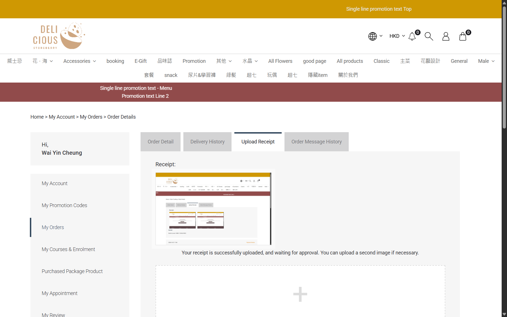

## Summary
After staff deny a bank transfer receipt, the customer's Upload Receipt tab keeps the old message 'Your receipt is successfully uploaded, and waiting for approval. You can upload a second image if necessary.' The rejection and the staff comment are only in the Remark history further down, and the Order Detail tab says STATUS Rejected. The customer is told the opposite of the real state right where they would act.

## Steps to reproduce
1. eShop member MEMy001164526: place a Bank Transfer order (C, 門市自取), Upload Receipt > Or Choose File > Submit -> 'successfully uploaded, and waiting for approval'
2. CRM: order detail > Receipt > comment 'amount not visible, please upload again' > Deny > OK -> Payment Rejected
3. eShop: reload My Orders > the order > Upload Receipt

## Expected
The tab says the receipt was rejected (showing the staff comment) and asks for a new receipt.

## Actual
'Your receipt is successfully uploaded, and waiting for approval. You can upload a second image if necessary.' with the old image; Remark below lists '2026-10-28 12:42 Rejected Aside QA test - deny: ...'. Same after the second deny (12:44). Order TXN0126102800013 (voided).

## Evidence
- Screenshot: 

## Environment
- Base URL: https://storeberry-flower.stagingl10.storeberry.xyz/my-account/orders-detail?txn_key=TXN0126102800013&tab=order-receipt
- Env: staging

## History
- 2026-10-28: filed from explorations/2026-10-28-payment-recovery.md in the Test Manager app.
