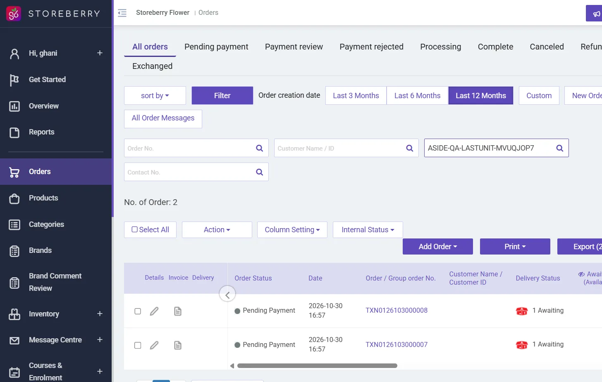
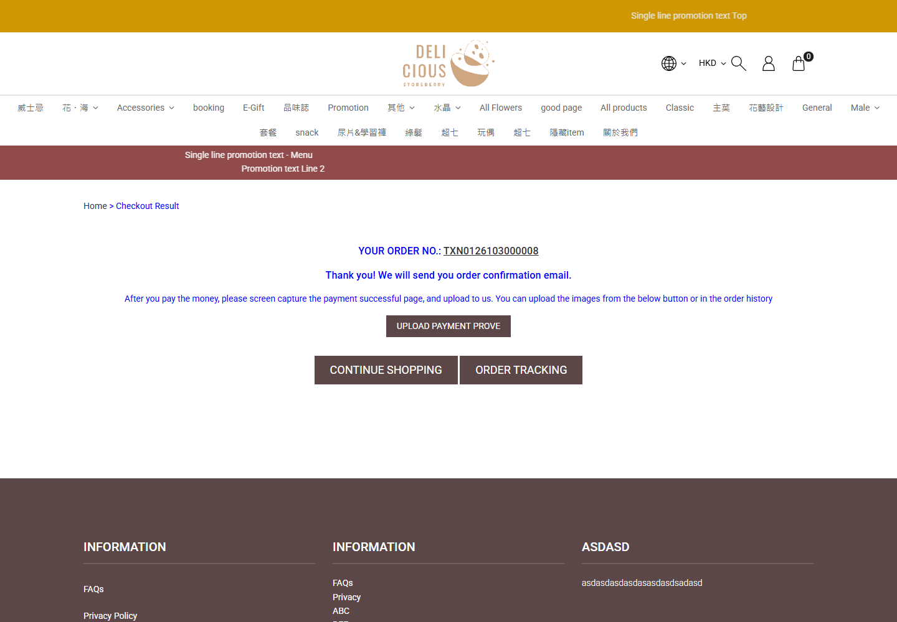
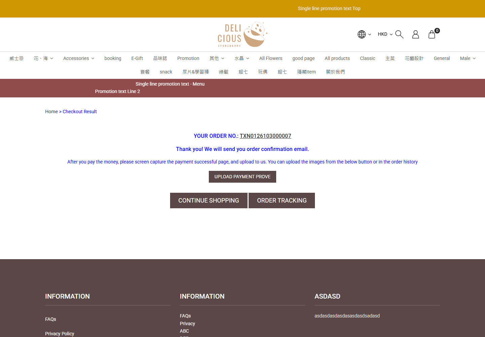
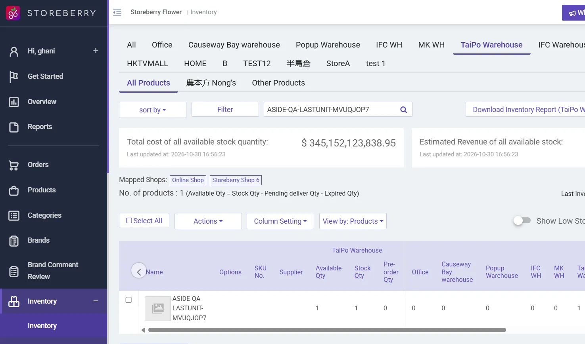

## Summary
Two independent shoppers each checked out one unit of the same stock-tracked product while only one unit was available. Both received order confirmations, leaving two unpaid orders and available stock of -1.

## Steps to reproduce
1. Prepare a regular physical product with Track Inventory enabled, Pre-order disabled, and exactly 1 unit in the warehouse serving Online Shop. Leave other warehouses at 0.
2. Open the eShop in two independent browser sessions. In each session, add 1 unit of the same product to an empty cart.
3. In both sessions, complete guest checkout details with different emails, choose store pickup, Bank Transfer and accept the terms.
4. Click Proceed to checkout in both sessions at nearly the same time.
5. In the CRM, filter orders by the product name and inspect its warehouse inventory.

## Expected
Only one checkout creates an order. The other shopper is told that stock is unavailable and gets no order. Available quantity is 0, never negative.

## Actual
Both shoppers reached thank-you pages. Shopper B created TXN0126103000007 (CRM 11061); shopper A created TXN0126103000008 (CRM 11062). Both were Pending payment, HKD 10.00, quantity 1, TaiPo Warehouse. The product ASIDE-QA-LASTUNIT-MVUQJOP7 (3204, variant 6063) changed from Available 1 / Stock 1 / Pre-order 0 to Available -1 / Stock 1 / Pre-order 1. The second order detail showed Pre-order Qty: 1 even though the product Pre-order switch was false. Both orders were voided afterward and Available 1 / Stock 1 / Pre-order 0 was restored.

## Evidence
- Inventory after concurrent checkout: 
- Two matching CRM orders: 
- Shopper A: 
- Shopper B: 
- Both checkout POST /checkout/fn-bank-transfer requests returned 200 at 2026-10-30T08:57:39.306Z and 2026-10-30T08:57:40.661Z.
- Cleanup: 

## Environment
- Base URL: https://storeberry-flower.stagingl10.storeberry.xyz/checkout
- Env: staging

## History
- 2026-10-30: filed from runs/2026-10-30_1557_staging_manual in the Test Manager app.
- 2026-10-30: status open -> wont-fix; User reports the same behavior without near-simultaneous submission and explicitly accepts it. Updated SBF-028 title, goal, steps and expectations to allow both prepared checkouts to succeed and stock to become negative. Removed active test linkage; no automated spec exists. Original observed failure and evidence remain unchanged..
