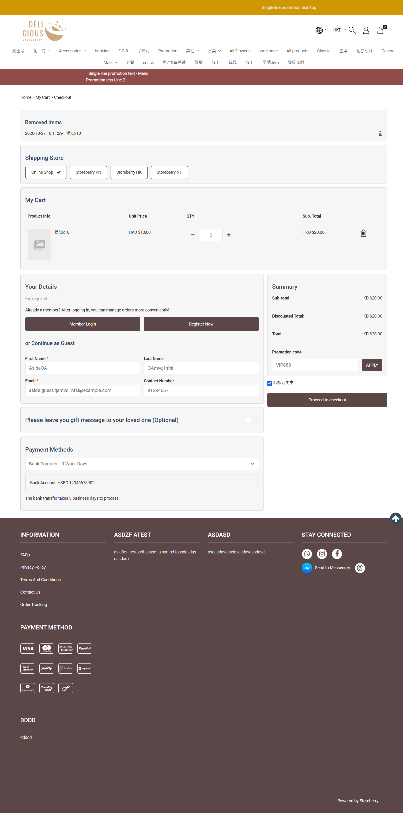

## Question
Is it intended that a cart with only 偈油x10 (Package product, 0 kg) shows no Shipping Address / Shipping Method section?

## Context
With 偈油x10 only, checkout has no delivery section; with test product EN 1 (2 kg) Shipping Address and 15 shipping methods appear. Packages are usage-based, so skipping delivery may be correct, but a 0 kg physical product would behave the same.

## Evidence
- Screenshot: 

## Answer
Not answered yet.

## History
- 2026-10-27: asked from explorations/2026-10-27-eshop-critical.md.
