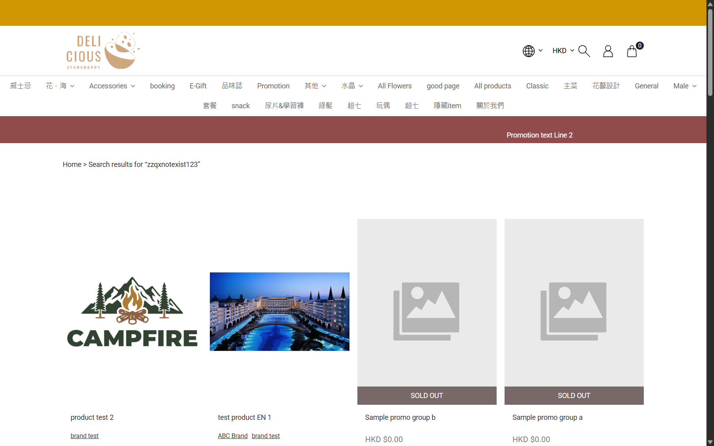

# Run report: storeberry-compare / exploratory-2026-10-27 / staging

| Field | Value |
|---|---|
| Result | **FAIL (5 failed)** |
| Run | 2026-10-27_1016_staging_manual |
| Runner | manual |
| Base URL | https://storeberry-flower.stagingl10.storeberry.xyz/ |
| Started | 2026-10-27 10:16 |
| Duration | 0.3s |

## Summary

| Total | Pass | Fail | Flaky | Blocked | Skipped |
|---:|---:|---:|---:|---:|---:|
| 14 | 9 | 5 | 0 | 0 | 0 |

## Results

| ID | Title | Status | Checks | Time | Notes | Evidence |
|---|---|---|---|---|---|---|
| SBF-001 | Home page loads | pass | 2/2 | 0.0s | - | - |
| SBF-002 | Product detail shows the selected product and price | pass | 2/2 | 0.0s | - | - |
| SBF-003 | Search results match the submitted product name | fail | 0/1 | 0.0s | product-bug; BUG-001 | [1](screenshots/SBF-003-m01-01-search-nonsense-query-returns-products.png) |
| SBF-005 | Member places a bank transfer order with store pickup | pass | 3/3 | 0.0s | - | [1](screenshots/SBF-005-m01-06-order-confirmation.png) |
| SBF-006 | New member registers and can log in | pass | 3/3 | 0.0s | - | - |
| SBF-007 | Registration validates policy, password length, confirmation and birthday | fail | 1/2 | 0.0s | product-bug; BUG-003 | - |
| SBF-008 | Product page rejects quantity below 1 and sold-out variants | pass | 2/2 | 0.0s | - | - |
| SBF-009 | Promotion code: invalid code message and whole-order discount | fail | 2/3 | 0.0s | product-bug; BUG-007 | - |
| SBF-010 | Checkout payment methods have readable unique names | fail | 0/2 | 0.0s | product-bug; BUG-004 | [1](screenshots/SBF-010-m01-03-checkout-payment-methods-raw-keys.png) |
| SBF-011 | Guest is told before checkout that a quota product needs login | fail | 1/2 | 0.0s | product-bug; BUG-005 | - |
| SBF-012 | Member uploads a bank transfer receipt | pass | 3/3 | 0.0s | - | [1](screenshots/SBF-012-m01-07-receipt-upload-whoops.png) |
| SBF-013 | Member edits profile and it syncs to the CRM | pass | 4/4 | 0.0s | - | - |
| SBF-014 | Member adds, edits and deletes an address | pass | 4/4 | 0.0s | - | - |
| SBF-015 | Member changes password and can only log in with the new one | pass | 5/5 | 0.0s | - | - |

## Failures and warnings

### SBF-003: Search results match the submitted product name (fail)

- Failure type: product-bug (bug BUG-001)
- Source: `projects/storeberry-compare/cases/search/SBF-003-search-results-match-the-submitted.md`
- Failed: Each returned product matches the query, including Disable Test when it is listed
- Note: Queries "Shoesss", "偈油x10" and "zzqxnotexist123" all return the same 24 unrelated products.

### SBF-007: Registration validates policy, password length, confirmation and birthday (fail)

- Failure type: product-bug (bug BUG-003)
- Source: `projects/storeberry-compare/cases/account/SBF-007-registration-validates-policy-password.md`
- Failed: Birthday 02-30 is rejected; no account is created with a different birthday
- Note: All three warnings shown; birthday 02-30 accepted and stored as 10-27.

### SBF-009: Promotion code: invalid code message and whole-order discount (fail)

- Failure type: product-bug (bug BUG-007)
- Source: `projects/storeberry-compare/cases/checkout/SBF-009-promotion-code-invalid-code-message-and.md`
- Failed: After REMOVE the discount line is gone, Total equals Sub-total and the promo box is empty
- Note: Invalid code message OK; VIP888 -HKD 20 OK; after REMOVE the promo box still shows "VIP888".

### SBF-010: Checkout payment methods have readable unique names (fail)

- Failure type: product-bug (bug BUG-004)
- Source: `projects/storeberry-compare/cases/checkout/SBF-010-checkout-payment-methods-have-readable.md`
- Failed: No option text starts with "order.checkout_v2."
- Failed: No two options have the same text
- Note: Raw keys order.checkout_v2.methods.fn-allinpay / aip-alipay (ocu-20000 now "Custom1"); FPS and PayMe duplicated.

### SBF-011: Guest is told before checkout that a quota product needs login (fail)

- Failure type: product-bug (bug BUG-005)
- Source: `projects/storeberry-compare/cases/checkout/SBF-011-guest-is-told-before-checkout-that-a.md`
- Failed: A message naming the product says login is required before the guest fills the form
- Note: Guest only warned after Proceed to checkout: "Member is requried for quota product." No order created.

## Notes

Results from the 2026-10-27 exploratory sessions (Aside browser). Only cases actually executed today are included; partially covered cases were left out. Explorations: explorations/2026-10-27-*.md
