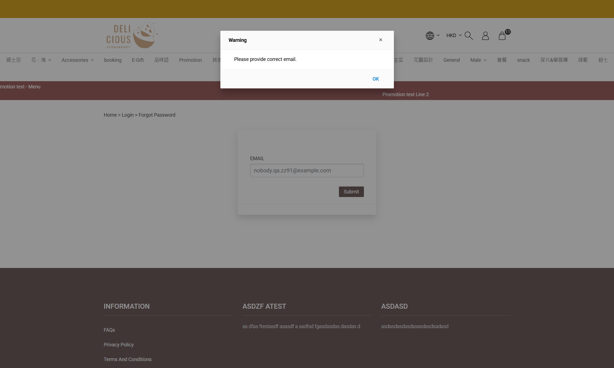

# Run report: storeberry-compare / exploratory-2026-10-27-guest / staging

| Field | Value |
|---|---|
| Result | **FAIL (1 failed)** |
| Run | 2026-10-27_1125_staging_manual |
| Runner | manual |
| Base URL | https://storeberry-flower.stagingl10.storeberry.xyz/ |
| Started | 2026-10-27 11:25 |
| Duration | 0.1s |

## Summary

| Total | Pass | Fail | Flaky | Blocked | Skipped |
|---:|---:|---:|---:|---:|---:|
| 3 | 2 | 1 | 0 | 0 | 0 |

## Results

| ID | Title | Status | Checks | Time | Notes | Evidence |
|---|---|---|---|---|---|---|
| SBF-016 | Guest places a bank transfer order with home delivery | pass | 3/3 | 0.0s | - | - |
| SBF-017 | Guest tracks an order by order number and email | pass | 4/4 | 0.0s | - | - |
| SBF-018 | Forgot password gives the same answer for registered and unknown emails | fail | 1/2 | 0.0s | product-bug; BUG-011 | [1](screenshots/SBF-018-m01-unknown-email.png) |

## Failures and warnings

### SBF-018: Forgot password gives the same answer for registered and unknown emails (fail)

- Failure type: product-bug (bug BUG-011)
- Source: `projects/storeberry-compare/cases/account/SBF-018-forgot-password-gives-the-same-answer.md`
- Failed: Registered and unknown emails get the same neutral confirmation
- Note: Registered -> Success; unknown -> "Please provide correct email."

## Notes

Exploratory session 2026-10-27: guest checkout, order tracking, forgot password.
