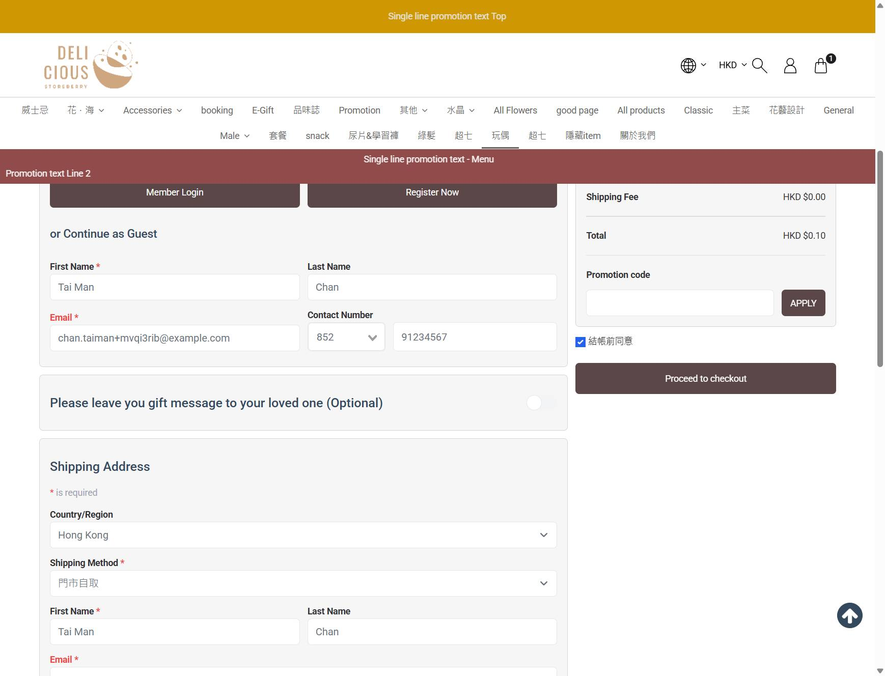

# Run report: storeberry-compare / exploratory-2026-10-27-cart-payment-review / staging

| Field | Value |
|---|---|
| Result | **FAIL (1 failed)** |
| Run | 2026-10-27_1652_staging_manual |
| Runner | manual |
| Base URL | https://storeberry-flower.stagingl10.storeberry.xyz/ |
| Started | 2026-10-27 16:52 |
| Duration | 0.1s |

## Summary

| Total | Pass | Fail | Flaky | Blocked | Skipped |
|---:|---:|---:|---:|---:|---:|
| 2 | 1 | 1 | 0 | 0 | 0 |

## Results

| ID | Title | Status | Checks | Time | Notes | Evidence |
|---|---|---|---|---|---|---|
| SBF-004 | Add and remove a product from the cart | pass | 3/3 | 0.0s | - | - |
| SBF-019 | Guest checkout accepts a plus-addressed email | fail | 0/2 | 0.0s | product-bug; BUG-012 | [1](screenshots/SBF-019-m01-email-plus-rejected.jpg) |

## Failures and warnings

### SBF-019: Guest checkout accepts a plus-addressed email (fail)

- Failure type: product-bug (bug BUG-012)
- Source: `projects/storeberry-compare/cases/checkout/SBF-019-guest-checkout-accepts-a-plus-addressed.md`
- Failed: The order is placed and the thank-you page shows the order number
- Failed: If an email is rejected, the message names the Email field and the reason
- Note: chan.taiman+<id>@example.com -> "Please fill all required info", Email labels red, no text (twice). Without "+" the order was placed (TXN0126102700016).

## Notes

Exploratory session explorations/2026-10-27-cart-payment-review.md
