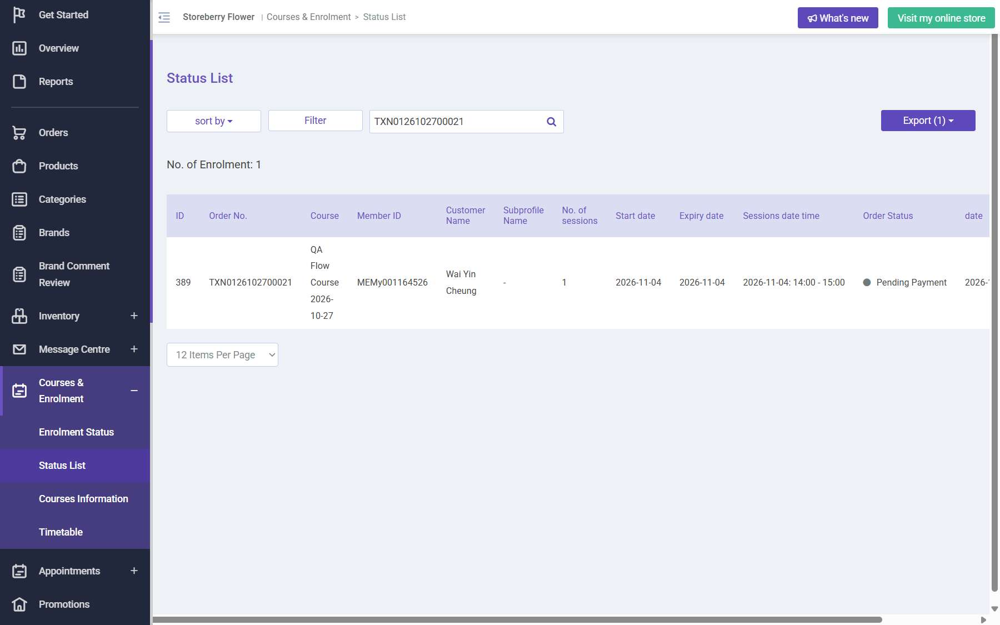
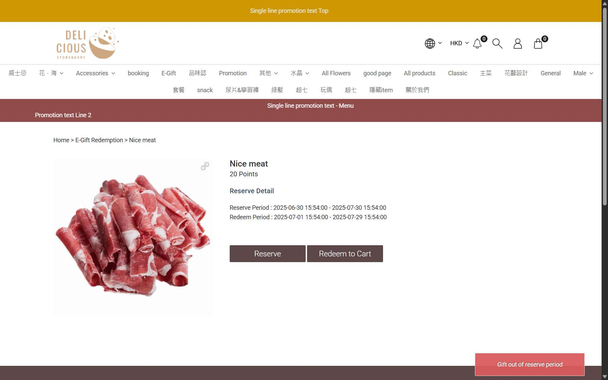

# Run report: storeberry-compare / exploratory-2026-10-27-course-egift-delivery / staging

| Field | Value |
|---|---|
| Result | **FAIL (2 failed)** |
| Run | 2026-10-27_1838_staging_manual |
| Runner | manual |
| Base URL | https://storeberry-flower.stagingl10.storeberry.xyz/ |
| Started | 2026-10-27 18:38 |
| Duration | 39.0s |

## Summary

| Total | Pass | Fail | Flaky | Blocked | Skipped |
|---:|---:|---:|---:|---:|---:|
| 3 | 1 | 2 | 0 | 0 | 0 |

## Results

| ID | Title | Status | Checks | Time | Notes | Evidence |
|---|---|---|---|---|---|---|
| SBF-021 | Course page only lets customers book upcoming sessions and books the chosen one | fail | 0/2 | 0.0s | test-issue | [1](screenshots/SBF-021-m01-enrolment-4-nov.jpg) |
| SBF-022 | Expired eGift cannot be reserved and the customer is told why | fail | 1/3 | 0.0s | test-issue | [1](screenshots/SBF-022-m01-expired-egift.jpg) |
| SBF-023 | Member places a home-delivery order and staff deliver it | pass | 3/3 | 0.0s | - | - |

## Failures and warnings

### SBF-021: Course page only lets customers book upcoming sessions and books the chosen one (fail)

- Failure type: test-issue
- Source: `projects/storeberry-compare/cases/courses/SBF-021-course-page-only-lets-customers-book.md`
- Failed: Past dates are disabled, or Apply is refused with a message
- Failed: If a date is accepted, the enrolment and cart show that same date
- Note: Picked 21 Oct and 14 Oct; both enrolled on 4 Nov.
- Note: Re-checked 2026-10-28: past session dates have CSS pointer-events: none (styles.css, unchanged since 27 Oct 02:53 GMT), so a real click does nothing ("Please select a date"). The 27 Oct run reached them through automation clicks that bypass CSS (a DOM element.click() for 14 Oct). Not reachable by a customer: BUG-014 withdrawn.

### SBF-022: Expired eGift cannot be reserved and the customer is told why (fail)

- Failure type: test-issue
- Source: `projects/storeberry-compare/cases/loyalty/SBF-022-expired-egift-cannot-be-reserved-and.md`
- Failed: A message says the gift is out of its reserve period (or Reserve is disabled)
- Failed: The API response contains no stack trace or server paths
- Note: No message; points untouched; response has a stack trace (BUG-016).
- Note: Re-checked 2026-10-27 from the saved screenshot: the page does show a toast "Gift out of reserve period" (bottom right). The check only looked for modals and missed the short-lived toast. BUG-015 withdrawn; no points were taken, so the case passes.

## Notes

Course, eGift, home delivery
