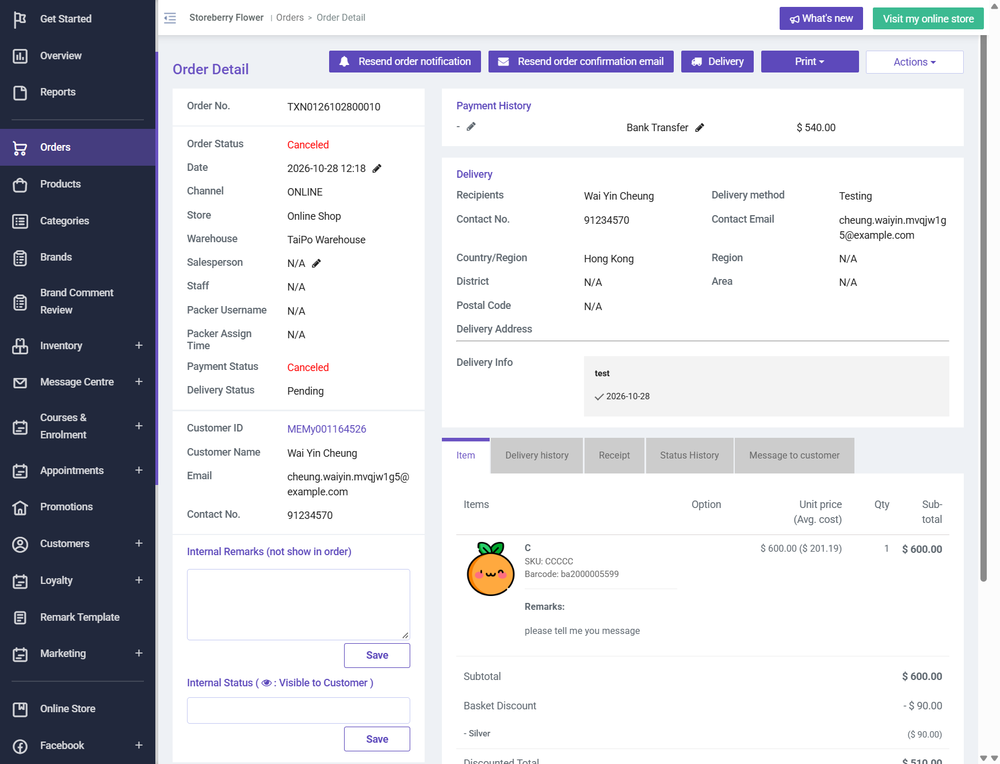

# Run report: storeberry-compare / exploratory-2026-10-28-shipping / staging

| Field | Value |
|---|---|
| Result | **FAIL (2 failed)** |
| Run | 2026-10-28_1127_staging_manual |
| Runner | manual |
| Base URL | https://storeberry-flower.stagingl10.storeberry.xyz/ |
| Started | 2026-10-28 11:27 |
| Duration | 0.9s |

## Summary

| Total | Pass | Fail | Flaky | Blocked | Skipped |
|---:|---:|---:|---:|---:|---:|
| 4 | 2 | 2 | 0 | 0 | 0 |

## Results

| ID | Title | Status | Checks | Time | Notes | Evidence |
|---|---|---|---|---|---|---|
| SBF-029 | Home delivery shipping fee matches the shipping method rule and is charged in the order total | pass | - | 0.0s | - | - |
| SBF-030 | Free-shipping threshold removes the fee at the threshold and adds it back when the basket drops below | pass | - | 0.0s | - | - |
| SBF-033 | Changing the cart at checkout never leaves a shipping fee without a shipping method | fail | - | 0.0s | product-bug; BUG-021 | [1](screenshots/SBF-033-m01-01-fee-kept-after-method-reset.png) |
| SBF-034 | Checkout refuses a delivery date outside the shipping method's allowed dates | fail | - | 0.0s | product-bug; BUG-020 | [1](screenshots/SBF-034-m01-04-crm-order-same-day-delivery-date.png) |

## Failures and warnings

### SBF-033: Changing the cart at checkout never leaves a shipping fee without a shipping method (fail)

- Failure type: product-bug (bug BUG-021)
- Source: `projects/storeberry-compare/cases/checkout/SBF-033-changing-the-cart-at-checkout-never.md`
- Note: Trash and - both reset Shipping Method to -- Select -- but Summary kept Shipping Fee 30 in Total (924 / 540).

### SBF-034: Checkout refuses a delivery date outside the shipping method's allowed dates (fail)

- Failure type: product-bug (bug BUG-020)
- Source: `projects/storeberry-compare/cases/checkout/SBF-034-checkout-refuses-a-delivery-date.md`
- Note: Picker blocks every date; typed text became today 2026-10-28 and TXN0126102800010 was placed with it (5 prep days required). Voided.

