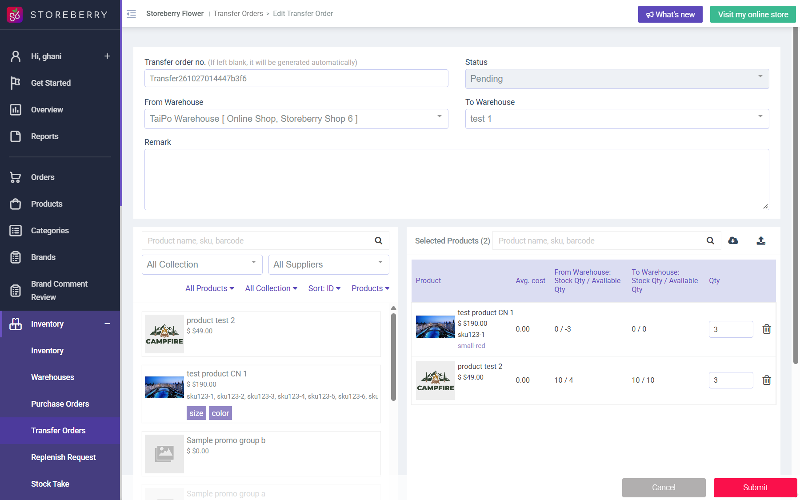

## Summary
Pending transfer 304 moves 3 x test product CN 1 (small-red, sku123-1) out of TaiPo Warehouse where Stock Qty is 0. The From Warehouse column now shows Stock / Available 0 / -3. The edit form also accepts a quantity of 99999 with no stock warning.

## Steps to reproduce
1. Open Inventory > Transfer Orders > Transfer261027014447b3f6 (id 304) > Edit Transfer Order
2. Read the From Warehouse Stock / Available column for test product CN 1 small-red
3. Type 99999 in its Qty (do not submit)

## Expected
A transfer cannot request more than the available quantity of the From Warehouse (or shows a clear warning), and available stock never goes negative.

## Actual
Line shows 0 / -3 with Qty 3; Qty 99999 is accepted by the form without any message. Replenish request 153 shows the same -3 for TaiPo.

## Evidence
- Screenshot: 
- Not submitted. Transfer 304 was created by the shared account earlier on 2026-10-27; creation-time validation not re-tested.

## Environment
- Base URL: https://www.stagingl10.storeberry.xyz/inventory/transfer-edit?id=304
- Env: staging

## History
- 2026-10-27: filed from explorations/2026-10-27-crm-eshop-critical.md in the Test Manager app.
- 2026-10-27: Creation path also unguarded (explorations/2026-10-27-stock-movement.md): Add Replenish Request Office -> TaiPo, product test 2 qty 999 while Office shows 45 / 45 reaches the Confirm dialog with no warning (not confirmed); screenshot ../explorations/2026-10-27-stock-movement/05-replenish-confirm-qty-999-over-available.jpg.
