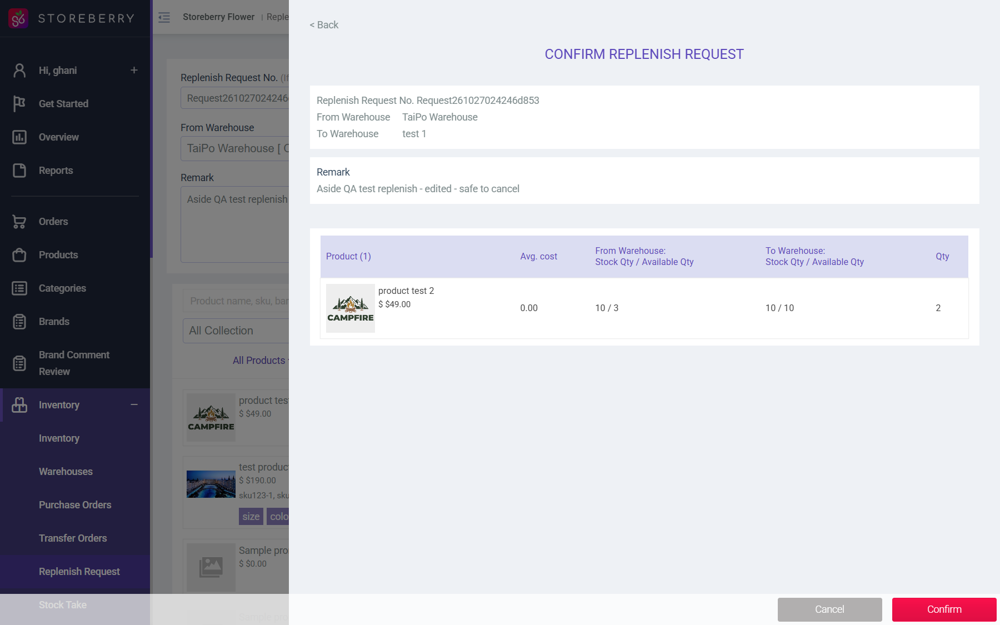
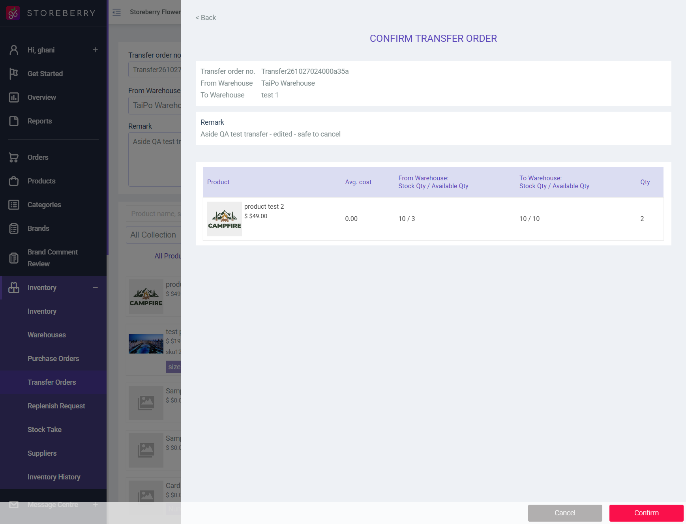

## Summary
Saving any edit of a Pending transfer order or an Awaiting replenish request fails. After Submit > Confirm, the page shows the toast "The deleted ids must be a valid JSON string." and nothing is saved. The POST /inventory/transfer-edit and /inventory/replenish-request-edit requests contain no deleted_ids field (even after removing a product row), but the backend validates deleted_ids as required JSON and answers HTTP 200 {"result":"FAIL","error_code":2208,"message":"The deleted ids must be a valid JSON string."}. Creating transfers and replenish requests works.

## Steps to reproduce
1. Inventory > Transfer Orders > Add Transfer Order: TaiPo Warehouse -> test 1, product test 2 qty 1, Submit > Confirm ("Create successful")
2. Open the new transfer > Edit Transfer Order, change Qty to 2 and the Remark, click Submit, then Confirm
3. Repeat with Inventory > Replenish Request > Add Replenish Request, then Edit Replenish Request > Submit > Confirm
4. Optional: in edit, delete the product row, re-add it and submit

## Expected
The edit is saved and the detail page shows the new quantity and remark.

## Actual
Toast "The deleted ids must be a valid JSON string." every time; detail page still shows qty 1 and the old remark. Same on transfer 306 and replenish request 154 (QA records, cancelled afterwards).

## Evidence
- Screenshot: 
- Screenshot: 
- Request body (transfer-edit): _token, selected_products=[{"id":644,"product_id":3198,"variant_id":6057,"qty":"2",...}], from_warehouse_id=12, to_warehouse_id=26, transfer_no, remark, updated_at, id=306. No deleted_ids.
- Response: {"result":"FAIL","success":false,"error_type":"ERROR_SHOW","error_code":2208,"message":"The deleted ids must be a valid JSON string."}
- Fix hint: send deleted_ids as "[]" from the edit form, or make the rule nullable on the server.
- Minor: cancelling a replenish request shows the toast "Cancelled transfer order".

## Environment
- Base URL: https://www.stagingl10.storeberry.xyz/inventory/transfer-edit?id=306
- Env: staging

## History
- 2026-10-27: filed from explorations/2026-10-27-crm-eshop-critical.md in the Test Manager app.
- 2026-10-27: status open -> fixed.
- 2026-10-27: status fixed -> verified.
- 2026-10-27: SCRM-083 and SCRM-084 notes updated: must pass.
